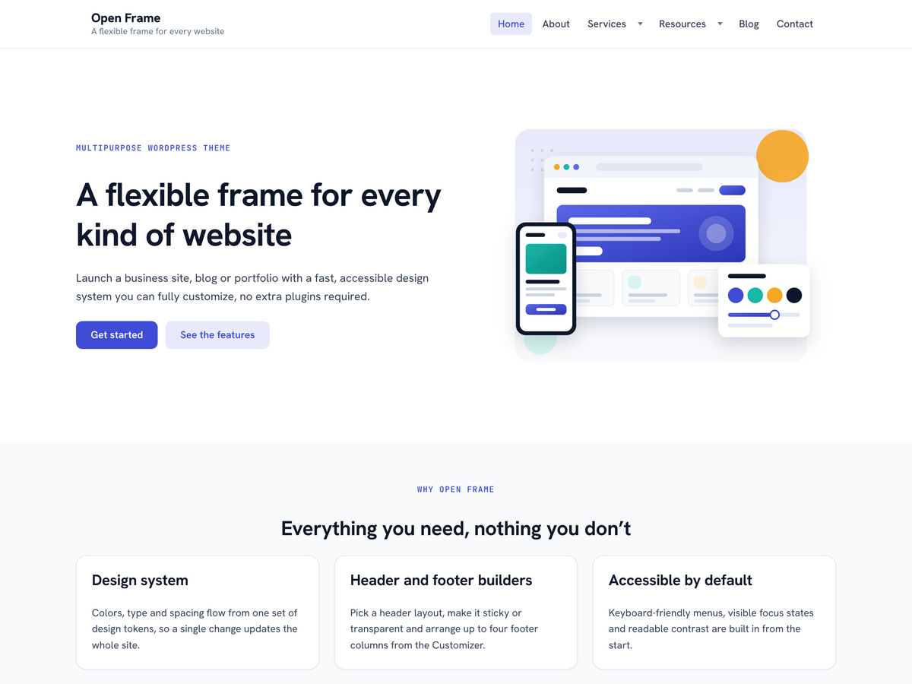

# Open Frame

A lightweight, accessibility-minded **multipurpose WordPress theme** built on a token-driven design system. Open Frame is controlled entirely from the Customizer, bundles its fonts locally, needs **no plugin** and makes **no remote requests**.



| | |
| --- | --- |
| **Version** | 1.0.1 |
| **Requires** | WordPress 6.4+, PHP 7.4+ (tested up to WordPress 7.1) |
| **License** | GPL-2.0-or-later |
| **Text domain** | `open-frame` |
| **Author** | [Mostafij Emon](https://github.com/Mostafijemon24) |

## Documentation

**[Read the full documentation →](docs/README.md)** — installation, quick start, every Customizer option, menus and the mega menu, templates, patterns, child themes and a developer reference, with screenshots. A standalone HTML copy is in [`docs/index.html`](docs/index.html).

## Features

- **Design system** — colors, typography, spacing, radius and elevation as CSS custom properties; change a color once and the whole site follows, including the block editor palette.
- **Customizer** — global colors, fonts, font size, line height, heading weight, container and content widths, section spacing. Every option has a visible effect.
- **Header builder** — five layouts, background and text colors, sticky and transparent modes, optional search, hide-title option.
- **Footer builder** — one to four widget columns (empty ones are skipped), footer colors, custom copyright text.
- **Navigation** — keyboard-friendly dropdowns, mobile menu, and a multi-column **mega menu** (add the class `of-mega` to a top-level menu item).
- **Layouts** — right sidebar, left sidebar, no sidebar and full width, set separately for the blog, posts and pages; blog as a list or a 2–4 column grid.
- **Templates** — Full Width and **Landing Page** (blank canvas for block-built pages).
- **Block editor** — six patterns, five block styles, shared palette, font sizes and spacing scale through `theme.json`.
- **Built in** — translation-ready, RTL-friendly, reduced-motion aware, usable without JavaScript, child-theme friendly.

## Installation

Download `open-frame-<version>.zip` from the [latest release](https://github.com/Mostafijemon24/Open-Frame-Theme/releases/latest), then in WordPress go to **Appearance → Themes → Add Theme → Upload Theme**, upload the ZIP, **Install** and **Activate**.

> Download the release ZIP rather than GitHub's "Source code" archive: the release package contains only the files the theme needs.

## Development

```
open-frame/
├── style.css, theme.json, functions.php   Theme entry points
├── inc/                                    Setup, Customizer, header/footer builders, template tags
├── page-templates/, template-parts/        Templates
├── patterns/                               Block patterns
├── assets/                                 CSS, JS, fonts, images
├── languages/                              Translation template
├── docs/                                   User documentation (not shipped in the ZIP)
└── bin/                                    Build scripts (not shipped in the ZIP)
```

**Coding standards.** PHP follows the WordPress Coding Standards and is checked for PHP 7.4+ compatibility:

```bash
composer global require squizlabs/php_codesniffer wp-coding-standards/wpcs phpcompatibility/phpcompatibility-wp dealerdirect/phpcodesniffer-composer-installer
```

```bash
phpcs
```

**Build the installable ZIP** (everything in [`.distignore`](.distignore) is left out):

```bash
bash bin/build-zip.sh
```

**Rebuild the HTML documentation** after editing `docs/README.md`:

```bash
npm install marked && node bin/build-docs.js
```

**Release.** Update the version in `style.css`, `functions.php` and `readme.txt`, add the changelog entry and push to `main`. Then either push a tag such as `v1.0.1`, or open **Actions → Release → Run workflow**. The [release workflow](.github/workflows/release.yml) builds the ZIP, creates the tag when needed and publishes the GitHub release.

Architecture notes and the test report for each release are in [`docs/dev/`](docs/dev/).

## Changelog

See the `== Changelog ==` section of [`readme.txt`](readme.txt).

## License

Open Frame is free software distributed under the GNU General Public License v2 or later. See [`LICENSE`](LICENSE). The bundled fonts (Hanken Grotesk, JetBrains Mono) are licensed under the SIL Open Font License 1.1; details are in [`readme.txt`](readme.txt).
