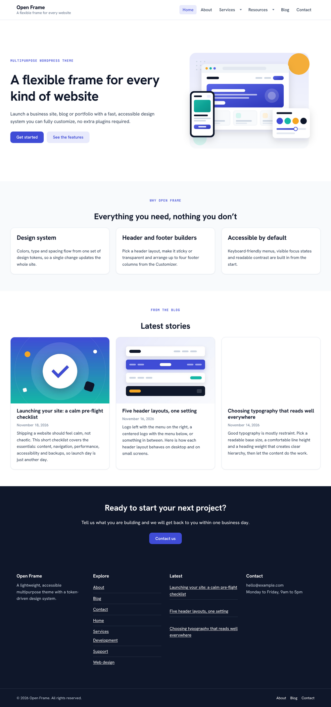
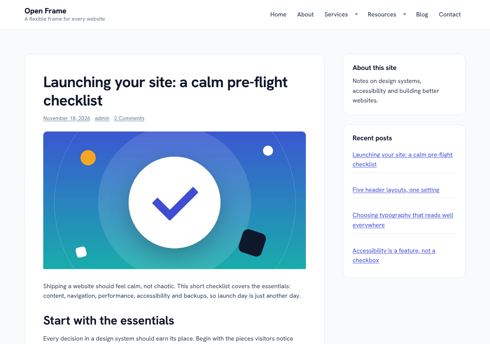
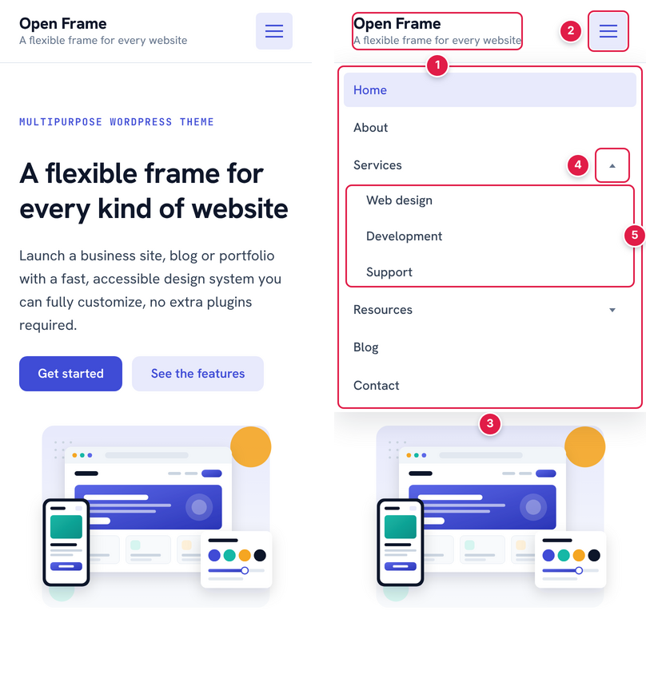
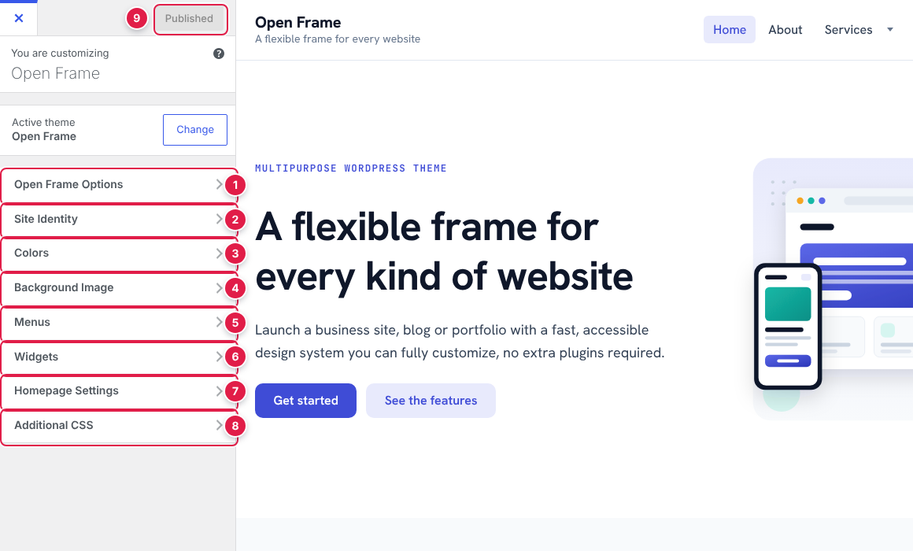
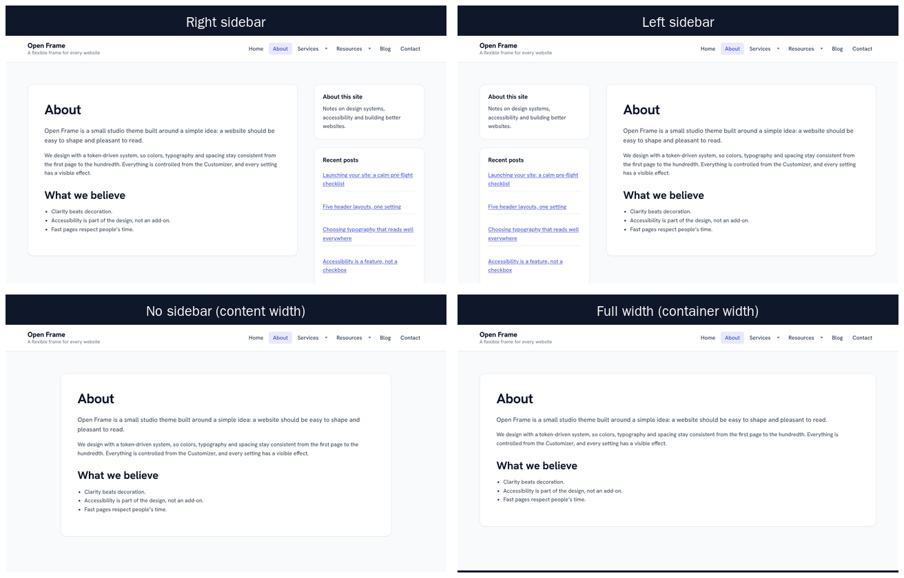
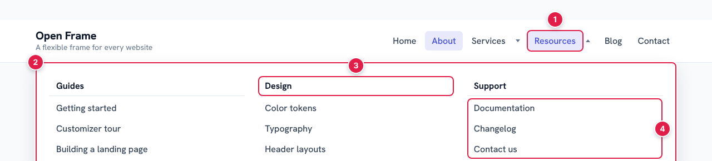
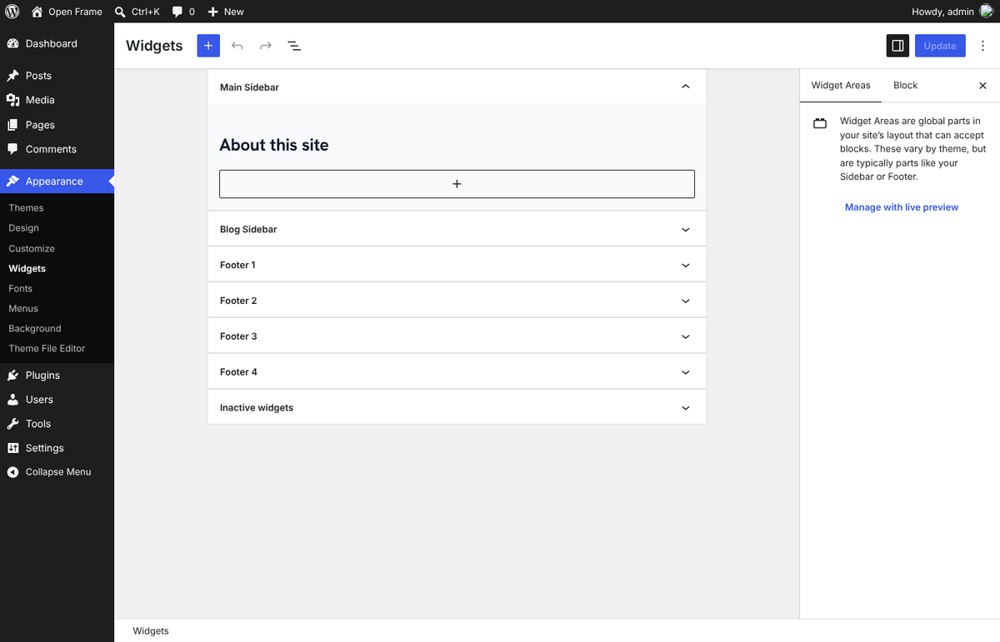

<p align="center">
  
</p>

# Open Frame

[](https://github.com/Mostafijemon24/Open-Frame-Theme/actions/workflows/ci.yml)
[](https://github.com/Mostafijemon24/Open-Frame-Theme/releases/latest)
[](LICENSE)
[](https://wordpress.org/)
[](https://www.php.net/)

A lightweight, accessibility-minded **multipurpose WordPress theme** built on a token-driven design system. Open Frame is controlled entirely from the Customizer, bundles its fonts locally, needs **no plugin** and makes **no remote requests**.

| | |
| --- | --- |
| **Version** | 1.2.0 |
| **Requires** | WordPress 6.4+, PHP 7.4+ (tested up to WordPress 7.1) |
| **License** | GPL-2.0-or-later |
| **Text domain** | `open-frame` |
| **Author** | [Mostafij Emon](https://github.com/Mostafijemon24) |

**[Read the full documentation →](docs/README.md)** · 26 chapters with numbered, annotated screenshots. A standalone HTML copy is in [`docs/index.html`](docs/index.html).

| Guide | For |
| --- | --- |
| [Theme guide](docs/README.md) | Every setting of the theme |
| [Starter Sites guide](docs/STARTER-SITES.md) | The companion plugin: choosing, importing, editing and rolling back one of the ten ready-made websites |
| [Installation guide](docs/INSTALL.md) | Installing, checking, updating and removing the theme and the plugin |
| [Support and update policy](docs/SUPPORT.md) | Where to get help, what is supported, how updates are published |
| [Changelog](CHANGELOG.md) | What changed in each version |
| [Developer documents](docs/dev/) | Architecture, the plugin's hooks and REST routes, the library, tests, the release checklist |
| [Contributing](CONTRIBUTING.md) · [Security](SECURITY.md) · [Code of conduct](CODE_OF_CONDUCT.md) | How to report a problem, propose a change or report a vulnerability |

## Contents

- [Screenshots](#screenshots)
- [Features](#features)
- [Installation](#installation)
- [Quick start](#quick-start)
- [Customization](#customization)
  - [Layout](#layout) · [Global Colors](#global-colors) · [Typography](#typography) · [Header Builder](#header-builder) · [Footer Builder](#footer-builder)
- [Home page and patterns](#home-page-and-patterns)
- [Menus and the mega menu](#menus-and-the-mega-menu)
- [Widget areas](#widget-areas)
- [Development](#development)
- [License](#license)

## Screenshots

**Home page** (Landing Page template with the bundled patterns)



**Blog**, in the grid style with a sidebar


**Single post**



**Phone**, with the menu closed and open



## Features

- **Design system** — colors, typography, spacing, radius and elevation as CSS custom properties. Change a color once and the whole site follows, including the block editor palette.
- **Customizer** — 39 settings in five sections, plus an Elementor section that appears while Elementor is active. Every setting has a visible effect and most preview instantly.
- **Header builder** — five layouts, background and text colors, sticky and transparent modes, optional search, hide-title option.
- **Footer builder** — one to four widget columns (empty ones are skipped), footer colors, custom copyright text.
- **Navigation** — keyboard-friendly dropdowns, a mobile menu, and a multi-column **mega menu** without a plugin.
- **Layouts** — right sidebar, left sidebar, no sidebar and full width, set separately for the blog, posts and pages. Blog as a list or a 2 to 4 column grid.
- **Templates** — Full Width and **Landing Page** (a blank canvas for block-built pages).
- **Block editor** — six patterns, five block styles, shared palette, font sizes and spacing scale through `theme.json`.
- **Elementor** — pages built with Elementor span the full width; the Canvas and Full Width templates and Elementor Pro's Theme Builder (header, footer, single, archive, 404) are supported. One optional setting makes the theme follow Elementor's global colors and fonts.
- **WooCommerce** — shop, product, cart, checkout and account pages use the theme's colors, buttons and cards.
- **Built in** — translation-ready, RTL-friendly, reduced-motion aware, usable without JavaScript, child-theme friendly.

## Installation

1. Download `open-frame-<version>.zip` from the [latest release](../../releases/latest).
2. In WordPress go to **Appearance → Themes → Add Theme → Upload Theme**.
3. Upload the ZIP, click **Install**, then **Activate**.

> Download the release ZIP rather than GitHub's "Source code" archive: the release package contains only the files the theme needs.

Every [release](../../releases) is a complete set: the theme, the Starter Sites plugin, and one archive with the source of each of the ten starter sites, with checksums. To build a website you need only the theme and, if you want a starter site, the plugin.

The [installation guide](docs/INSTALL.md) covers checking the download, updating and removing.

### Starter sites (optional)

The companion plugin **Open Frame Starter Sites** adds ten complete websites made with Elementor for this theme, five for free Elementor and five for Elementor Pro. It is a separate download, `open-frame-starter-sites-<version>.zip`, installed under **Plugins → Add Plugin → Upload Plugin**. See the [Starter Sites guide](docs/STARTER-SITES.md).


> The plugin is released on this repository's [releases page](../../releases). It is not in the WordPress.org Plugin Directory yet. Once it is, the theme offers to install it with one click: see [Integration with the Starter Sites plugin](docs/dev/INTEGRATION.md). The state of both submissions is in [FINAL_INTEGRATION_REPORT.md](docs/dev/FINAL_INTEGRATION_REPORT.md).


## Quick start

| Step | Where | What to do |
| --- | --- | --- |
| 1 | Customize → Site Identity | Upload a logo, set the site title and tagline |
| 2 | Appearance → Menus | Create a menu and assign it to **Primary Menu** |
| 3 | Pages → Add New | Create a home page with the **Landing Page** template and the **Landing page** pattern |
| 4 | Settings → Reading | Choose that page as the **Homepage** and another page as the **Posts page** |
| 5 | Appearance → Widgets | Add blocks to the sidebars and the footer columns |
| 6 | Customize → Open Frame Options | Pick colors, fonts, the header layout and the footer columns |

## Customization

All theme settings live under **Appearance → Customize → Open Frame Options**. The red numbers on each screenshot match the rows of the table below it.



| # | Section | Used for |
| --- | --- | --- |
| 1 | **Open Frame Options** | All theme settings: layout, colors, typography, header and footer |
| 2 | Site Identity | Logo, site title, tagline and site icon |
| 3 | Colors | WordPress background color |
| 4 | Background Image | An optional image behind the whole page |
| 5 | Menus | Create menus and assign them to locations |
| 6 | Widgets | Edit the sidebar and footer widget areas |
| 7 | Homepage Settings | Choose a static home page and the posts page |
| 8 | Additional CSS | Your own CSS |
| 9 | Publish | Saves your changes and makes them live |


### Layout


| # | Setting | Default | Range / choices | What it does |
| --- | --- | --- | --- | --- |
| 1 | Site layout | Full width | Full width, Boxed | Full-window site, or the whole site in a centered box |
| 2 | Container width | 1200 px | 800 to 1600 | Maximum width of the header, footer and sidebar layouts |
| 3 | Content width | 960 px | 600 to 1400 | Width of the *No sidebar* column and of blocks on the Landing Page template |
| 4 | Section spacing | 64 px | 16 to 160 | Space above and below the main content area |
| 5 | Blog listing style | List | List, Grid | Image beside the text, or cards in columns |
| 6 | Grid columns | 2 | 2 to 4 | Columns of the Grid style (shown only for Grid) |
| 7 | Excerpt length | 30 words | 5 to 80 | Length of post summaries |
| 8 | Blog / archive layout | Right sidebar | 4 layouts | Layout of the blog, archives and search |
| 9 | Single post layout | Right sidebar | 4 layouts | Layout of single posts |
| 10 | Default page layout | No sidebar | 4 layouts | Layout of pages with the default template |



### Global Colors


| # | Setting | Default | Used for |
| --- | --- | --- | --- |
| 1 | Primary | `#3f4cd6` | Buttons, active menu items, highlights, focus outline |
| 2 | Primary (hover) | `#2b36b8` | Buttons on hover |
| 3 | Secondary | `#14b8a6` | The *Secondary* color in the editor palette |
| 4 | Accent | `#f5a623` | Highlighted text, and the *Accent* palette color |
| 5 | Headings | `#0f172a` | Headings and post titles |
| 6 | Body text | `#334155` | Paragraphs, summaries, form labels |
| 7 | Links | `#3f4cd6` | Links in content |
| 8 | Link hover | `#2b36b8` | Links on hover and focus |
| 9 | Borders | `#e2e8f0` | Card, table and divider lines |
| 10 | Page background | `#f8fafc` | The page behind the content cards |
| 11 | Surfaces | `#ffffff` | Cards, dropdown menus and form fields |

A new primary color, a dark header and serif headings, set entirely in the Customizer:


### Typography


| # | Setting | Default | Range / choices | What it does |
| --- | --- | --- | --- | --- |
| 1 | Body font | Hanken Grotesk | Hanken Grotesk, System UI, Serif, Monospace | Font for text |
| 2 | Heading font | Hanken Grotesk | Same four choices | Font for headings |
| 3 | Base font size | 16 px | 14 to 22 | Size of body text |
| 4 | Body line height | 160 % | 120 to 200 | Space between lines |
| 5 | Heading weight | 700 | 400 to 900 | Thickness of all headings |

### Header Builder


| # | Setting | Default | What it does |
| --- | --- | --- | --- |
| 1 | Header layout | Logo left, menu right | One of the five arrangements below |
| 2 | Header background | `#ffffff` | Background of the header bar and the mobile menu panel |
| 3 | Header text color | *(empty)* | Color of the site title, tagline and menu links |
| 4 | Show site title and tagline | On | Hide the text when the logo already contains the name |
| 5 | Sticky header | Off | Keeps the header at the top while scrolling |
| 6 | Transparent header on front page | Off | Removes the header background on the front page |
| 7 | Show search in header | Off | Adds a search form to the header |


| # | Layout |
| --- | --- |
| 1 | Logo left, menu right (default) |
| 2 | Logo left, menu centered |
| 3 | Centered logo, menu below |
| 4 | Logo & menu left (shown with the search form) |
| 5 | Logo right, menu left |

### Footer Builder


| # | Setting | Default | What it does |
| --- | --- | --- | --- |
| 1 | Show footer widget area | On | Shows or hides the widget columns |
| 2 | Footer columns | 4 columns | Maximum number of widget columns (1 to 4) |
| 3 | Footer background | `#0f172a` | Background color of the footer |
| 4 | Footer text color | `#cbd5e1` | Color of footer text |
| 5 | Footer heading and link color | `#ffffff` | Color of footer headings and links |
| 6 | Copyright text | *(empty)* | Custom text for the copyright bar; basic HTML allowed |


## Home page and patterns

1. Create a page and choose the **Landing Page** template (markers 1 and 2).

   

2. Open the inserter (1), the **Patterns** tab (2) and the **Open Frame** category (3), then click a pattern (4).

   

3. Set the page as the homepage under **Settings → Reading**.

| Pattern | Description |
| --- | --- |
| Hero | Centered headline, text and two buttons |
| Hero with illustration | Two columns with a headline, buttons and an illustration |
| Feature cards | A section heading and three cards |
| Latest posts grid | A section heading and the three most recent posts |
| Call to action | A dark full-width band with a headline and a button |
| Landing page | All of the above combined into a complete home page |

## Menus and the mega menu

Two menu locations: **Primary Menu** (header) and **Footer Menu** (copyright bar).

To turn a dropdown into a mega menu, enable **CSS Classes** in **Screen Options** and add the class `of-mega` to a top-level item:


| # | What it is |
| --- | --- |
| 1 | The top-level item that becomes the mega menu |
| 2 | The **CSS Classes** field with `of-mega` |
| 3 | A direct sub-item: it becomes a **column heading** |
| 4 | An item nested below it: it becomes a **link** in that column |
| 5 | **Save Menu** |



## Widget areas



| # | Widget area | Appears on |
| --- | --- | --- |
| 1 | Main Sidebar | Pages and single posts that use a sidebar layout |
| 2 | Blog Sidebar | The blog, archives and search results |
| 3 to 6 | Footer 1 to Footer 4 | The footer columns, from left to right |
| 7 | **+** | Adds a block to the selected area |
| 8 | Update | Saves your widgets |

Empty areas are never shown.

## Development

```
open-frame/
├── style.css, theme.json, functions.php   Theme entry points
├── inc/                                    Setup, Customizer, header/footer builders, template tags
├── page-templates/, template-parts/        Templates
├── patterns/                               Block patterns
├── assets/                                 CSS, JS, fonts, images
├── languages/                              Translation template
├── docs/                                   User documentation (not shipped in the ZIP)
├── companion/open-frame-starter-sites/     Companion plugin: the Starter Sites screen (own ZIP, not part of the theme)
├── starter-sites/                          Sources of the starter site library (one folder per design)
├── tools/                                  Build, sign and publish the library
├── cloud/worker/                           The Cloudflare Worker that serves the library
├── schemas/                                JSON Schemas of the catalog, its signed envelope and a site manifest
├── tests/                                  Test site setup, PHP and browser checks (not shipped in the ZIP)
└── bin/                                    Build scripts (not shipped in the ZIP)
```

**Coding standards.** PHP follows the WordPress Coding Standards and is checked for PHP 7.4+ compatibility:

```bash
composer install
```

```bash
composer lint
```

**Tests.** A script builds a disposable WordPress site (SQLite, PHP's built-in server) with Elementor, WooCommerce and Theme Check, and links this folder into it as the theme. The browser checks need Node.js 20+ and Playwright. See [docs/dev/TESTING.md](docs/dev/TESTING.md).

```bash
bash tests/env/setup.sh
```

```bash
node --test --test-concurrency=1 tests/e2e/*.test.js
```

```bash
bash tests/env/theme-check.sh
```

**Build the installable ZIP** (everything in [`.distignore`](.distignore) is left out):

```bash
bash bin/build-zip.sh
```

**Companion plugin.** [Open Frame Starter Sites](companion/open-frame-starter-sites) is a separate plugin that imports complete starter websites. It is not part of the theme ZIP. Its hooks, constants and REST routes are in [docs/dev/PLUGIN.md](docs/dev/PLUGIN.md). Build it with:

```bash
bash bin/build-plugin-zip.sh
```

**Rebuild the HTML documentation and `CHANGELOG.md`** after editing one of the guides in `docs/` or a changelog in a `readme.txt`:

```bash
npm install --no-save marked@18.3.0 && node bin/build-docs.js
```

**Retake the screenshots of the guides** on a test site (see the head of the file for what the site needs):

```bash
node bin/docs-shots.js http://localhost:8890
```

**Redraw the banner and icon of the plugin's WordPress.org page** (kept in `companion/open-frame-starter-sites/.wordpress-org/`, not shipped in the ZIP):

```bash
node bin/wporg-assets.js
```

**Release.** The theme and the plugin are released separately, each with its own version and tag (`v1.1.0`, `starter-sites-v1.0.0`). Go through the [release checklist](docs/dev/RELEASE.md), try the packaging with `bash bin/release-package.sh theme` (or `plugin`), then open **Actions → Release → Run workflow** or push the tag. The [release workflow](.github/workflows/release.yml) checks the version numbers and the changelog, builds the ZIP with its checksum and publishes a GitHub release.

Architecture notes, the test reports and the release checklist are in [`docs/dev/`](docs/dev/). The changelogs are in the two `readme.txt` files and, gathered, in [`CHANGELOG.md`](CHANGELOG.md).

## License

Open Frame is free software distributed under the GNU General Public License v2 or later. See [`LICENSE`](LICENSE). The bundled fonts (Hanken Grotesk, JetBrains Mono) are licensed under the SIL Open Font License 1.1; details are in [`readme.txt`](readme.txt).
