# Open Frame — Theme Documentation

**Version 1.0.1** · Requires WordPress 6.4+ and PHP 7.4+ · Tested up to WordPress 7.1 · GPL-2.0-or-later

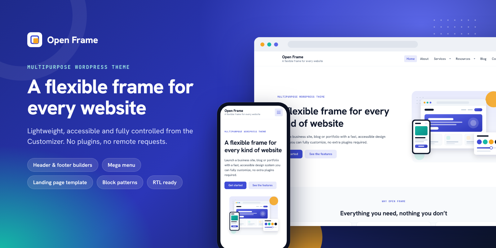

Open Frame is a lightweight, accessibility-minded multipurpose WordPress theme for business sites, blogs and portfolios. Everything is controlled from the Customizer, no plugin is required, and the fonts are bundled so the theme never calls a remote server.

**How to read this guide.** Many screenshots carry red numbered markers. The table under each screenshot explains every number, so you can match what you see on screen with the explanation.

## Contents

1. [Requirements](#1-requirements)
2. [Installation](#2-installation)
3. [Quick start](#3-quick-start)
4. [Site anatomy](#4-site-anatomy)
5. [The Customizer](#5-the-customizer)
6. [Site Identity: logo, title and icon](#6-site-identity-logo-title-and-icon)
7. [Layout settings](#7-layout-settings)
8. [Global Colors](#8-global-colors)
9. [Typography](#9-typography)
10. [Header Builder](#10-header-builder)
11. [Footer Builder](#11-footer-builder)
12. [Building the home page](#12-building-the-home-page)
13. [Menus and the mega menu](#13-menus-and-the-mega-menu)
14. [Widget areas](#14-widget-areas)
15. [Page templates](#15-page-templates)
16. [Blog and posts](#16-blog-and-posts)
17. [Block editor features](#17-block-editor-features)
18. [Fonts](#18-fonts)
19. [Customization recipes](#19-customization-recipes)
20. [Accessibility, RTL and translation](#20-accessibility-rtl-and-translation)
21. [Child themes and developer reference](#21-child-themes-and-developer-reference)
22. [Privacy and performance](#22-privacy-and-performance)
23. [Troubleshooting and FAQ](#23-troubleshooting-and-faq)
24. [Changelog, credits and support](#24-changelog-credits-and-support)

---

## 1. Requirements

| Item | Requirement |
| --- | --- |
| WordPress | 6.4 or newer (tested up to 7.1) |
| PHP | 7.4 or newer |
| Plugins | None. Open Frame works on its own |
| Browser support | Current versions of Chrome, Edge, Firefox and Safari |

## 2. Installation

### From the WordPress dashboard

1. Go to **Appearance → Themes**.
2. Click **Add Theme** (marker 3 below).
3. Search for **Open Frame** and click **Install**. If you downloaded the theme as a ZIP file, choose **Upload Theme** and select `open-frame.zip` instead.
4. Click **Activate**.

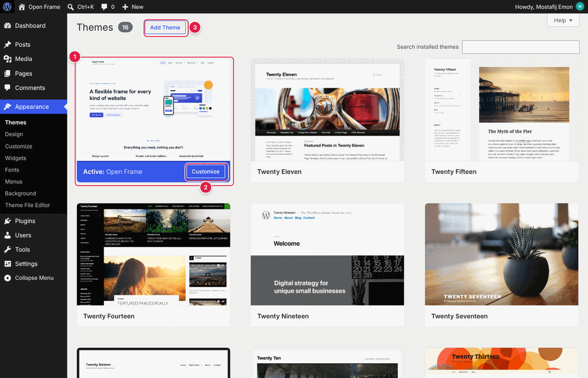

| # | What it is |
| --- | --- |
| 1 | Open Frame, the active theme |
| 2 | **Customize** opens the Customizer with all theme settings |
| 3 | **Add Theme** installs or uploads a theme |

### Manual installation (SFTP)

1. Unzip `open-frame.zip`.
2. Upload the `open-frame` folder to `wp-content/themes/`.
3. Activate the theme under **Appearance → Themes**.


> The theme works immediately after activation. With no menu, no widgets and no settings changed it shows a clean header with your site title, your posts, and a simple copyright bar.

## 3. Quick start

Six steps take a fresh install to a finished site. Each step links to its full chapter.

| Step | Where | What to do | Chapter |
| --- | --- | --- | --- |
| 1 | Customize → Site Identity | Upload a logo, set the site title and tagline | [6](#6-site-identity-logo-title-and-icon) |
| 2 | Appearance → Menus | Create a menu and assign it to **Primary Menu** | [13](#13-menus-and-the-mega-menu) |
| 3 | Pages → Add New | Create a home page with the **Landing Page** template and the **Landing page** pattern | [12](#12-building-the-home-page) |
| 4 | Settings → Reading | Choose that page as the **Homepage** and another page as the **Posts page** | [12](#12-building-the-home-page) |
| 5 | Appearance → Widgets | Add blocks to the sidebars and the footer columns | [14](#14-widget-areas) |
| 6 | Customize → Open Frame Options | Pick colors, fonts, the header layout and the footer columns | [7](#7-layout-settings) to [11](#11-footer-builder) |

## 4. Site anatomy

These annotated pages show which part of the site each setting controls.

### Home page (Landing Page template)

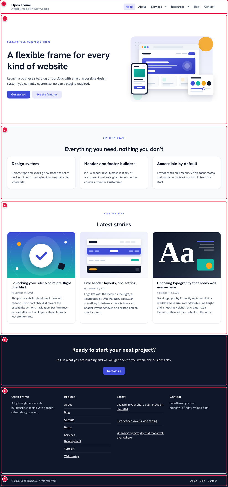

| # | Part | Where you change it |
| --- | --- | --- |
| 1 | Header | [Header Builder](#10-header-builder), [Site Identity](#6-site-identity-logo-title-and-icon), [Menus](#13-menus-and-the-mega-menu) |
| 2 | Hero with illustration (pattern) | Edit the page in the block editor |
| 3 | Feature cards (pattern) | Edit the page in the block editor |
| 4 | Latest posts grid (pattern) | Edit the page; the posts come from your blog |
| 5 | Call to action (pattern) | Edit the page in the block editor |
| 6 | Footer widget columns | [Widgets](#14-widget-areas), [Footer Builder](#11-footer-builder) |
| 7 | Copyright bar and footer menu | [Footer Builder](#11-footer-builder), [Menus](#13-menus-and-the-mega-menu) |

### Header

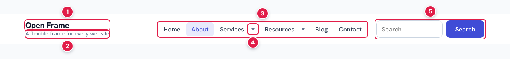

| # | Part | Where you change it |
| --- | --- | --- |
| 1 | Site title (or your logo) | Customize → Site Identity |
| 2 | Tagline | Customize → Site Identity |
| 3 | Primary menu | Appearance → Menus |
| 4 | Arrow button of a menu item with sub-items | Added automatically |
| 5 | Search form | Header Builder → *Show search in header* |

### Blog page

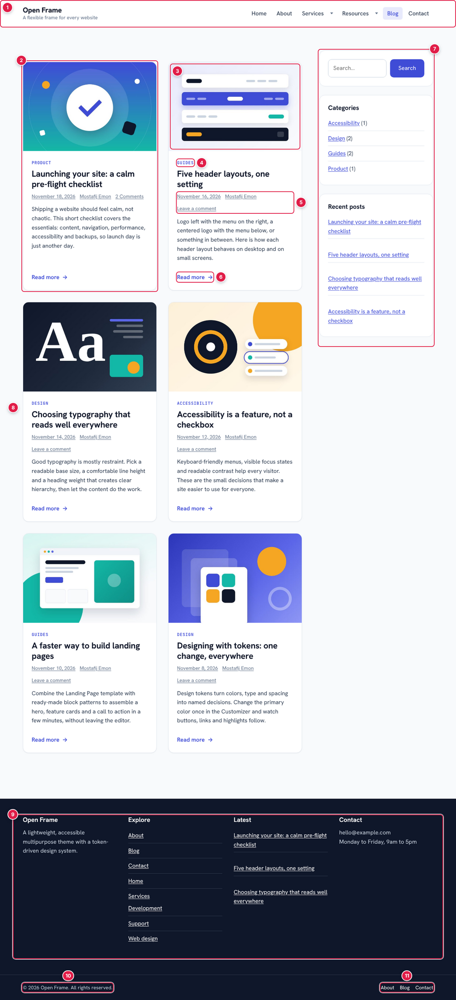

| # | Part | Where you change it |
| --- | --- | --- |
| 1 | Header | Header Builder |
| 2 | Post card | Layout → *Blog listing style* |
| 3 | Featured image | **Featured image** in the post editor |
| 4 | Category label (first category of the post) | Post categories |
| 5 | Date, author and comment link | Automatic |
| 6 | Read more link | Automatic |
| 7 | Blog Sidebar | Appearance → Widgets; Layout → *Blog / archive layout* |
| 8 | Post listing (List, or Grid with 2 to 4 columns) | Layout → *Blog listing style* and *Grid columns* |
| 9 | Footer widget columns | Appearance → Widgets; Footer Builder |
| 10 | Copyright text | Footer Builder → *Copyright text* |
| 11 | Footer menu | Appearance → Menus → **Footer Menu** |

### Single post

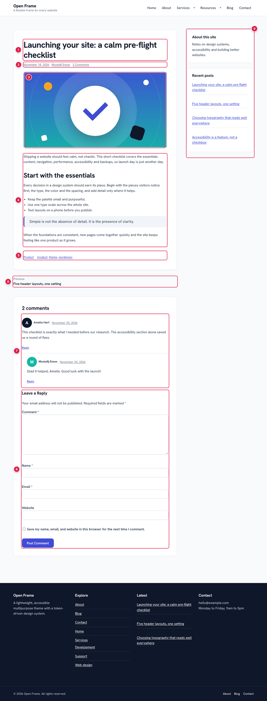

| # | Part | Notes |
| --- | --- | --- |
| 1 | Post title | |
| 2 | Date, author and comment link | |
| 3 | Featured image | Shown as a 1200 × 630 crop |
| 4 | Post content | Written in the block editor |
| 5 | Categories and tags | An **Edit** link is added for logged-in editors |
| 6 | Links to the previous and next post | |
| 7 | Comments | Replies are indented under their parent comment |
| 8 | Comment form | Shown while comments are open |
| 9 | Main Sidebar | Layout → *Single post layout* |

## 5. The Customizer

Open **Appearance → Customize**. The preview on the right updates while you change settings on the left; nothing is saved until you click **Publish**.


| # | Section | Used for |
| --- | --- | --- |
| 1 | **Open Frame Options** | All theme settings: layout, colors, typography, header and footer |
| 2 | Site Identity | Logo, site title, tagline and site icon |
| 3 | Colors | WordPress background color (see the note in [Global Colors](#8-global-colors)) |
| 4 | Background Image | An optional image behind the whole page |
| 5 | Menus | Create menus and assign them to locations |
| 6 | Widgets | Edit the sidebar and footer widget areas with a live preview |
| 7 | Homepage Settings | Choose a static home page and the posts page |
| 8 | Additional CSS | Your own CSS, see [Customization recipes](#19-customization-recipes) |
| 9 | Publish | Saves your changes and makes them live |

Use the three device buttons at the bottom of the panel to preview the site on desktop, tablet and phone widths.

Click **Open Frame Options** to see the five theme sections:


| # | Section | Chapter |
| --- | --- | --- |
| 1 | Layout | [7](#7-layout-settings) |
| 2 | Global Colors | [8](#8-global-colors) |
| 3 | Typography | [9](#9-typography) |
| 4 | Header Builder | [10](#10-header-builder) |
| 5 | Footer Builder | [11](#11-footer-builder) |

## 6. Site Identity: logo, title and icon

**Customize → Site Identity**

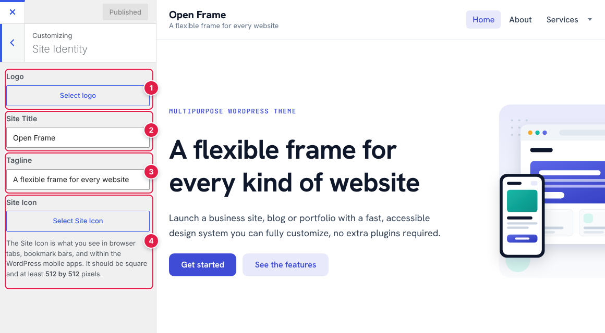

| # | Setting | What it does |
| --- | --- | --- |
| 1 | Logo | Shown in the header before the site title. Any size works; the logo is scaled to a maximum height of 56 px. About 180 × 48 px, or twice that for sharp display on high-resolution screens, is a good size |
| 2 | Site Title | The name shown in the header, the browser tab and the default copyright line |
| 3 | Tagline | A short line under the site title. Leave it empty to show no tagline |
| 4 | Site Icon | The small icon in browser tabs and bookmarks (512 × 512 px recommended) |

If your logo already contains the site name, hide the text with **Header Builder → Show site title and tagline**. The name stays available to screen readers and search engines.

## 7. Layout settings

**Customize → Open Frame Options → Layout**


| # | Setting | Default | Range / choices | What it does |
| --- | --- | --- | --- | --- |
| 1 | Site layout | Full width | Full width, Boxed | **Full width** lets the header and footer span the window. **Boxed** places the whole site in a centered box with a shadow |
| 2 | Container width | 1200 px | 800 to 1600 | Maximum width of the header, the footer and the sidebar layouts |
| 3 | Content width | 960 px | 600 to 1400 | Width of the content column in the *No sidebar* layout, and of default blocks on the Landing Page template |
| 4 | Section spacing | 64 px | 16 to 160 | Space above and below the main content area. The default shrinks automatically on small screens |
| 5 | Blog listing style | List | List, Grid | **List** shows the image beside the text. **Grid** shows cards in columns |
| 6 | Grid columns | 2 | 2 to 4 | Number of columns for the Grid style. Shown only while the style is Grid |
| 7 | Excerpt length | 30 words | 5 to 80 | Length of post summaries in listings |
| 8 | Blog / archive layout | Right sidebar | 4 layouts | Layout of the blog, category, tag, author, date and search pages |
| 9 | Single post layout | Right sidebar | 4 layouts | Layout of single posts |
| 10 | Default page layout | No sidebar | 4 layouts | Layout of pages that use the default template |

### The four layouts


- **Right sidebar** and **Left sidebar:** content with a 320 px sidebar. If the sidebar has no widgets, the content is centered at the content width instead of leaving an empty column. On screens narrower than 1024 px the sidebar moves below the content.
- **No sidebar (content width):** a single centered column, as wide as the *Content width* setting.
- **Full width (container width):** a single column that fills the container.

### Boxed site layout


With **Boxed**, the site sits in a centered box as wide as the *Container width*. The page background (set in Global Colors, or a WordPress background image) shows on both sides.

### Blog listing styles

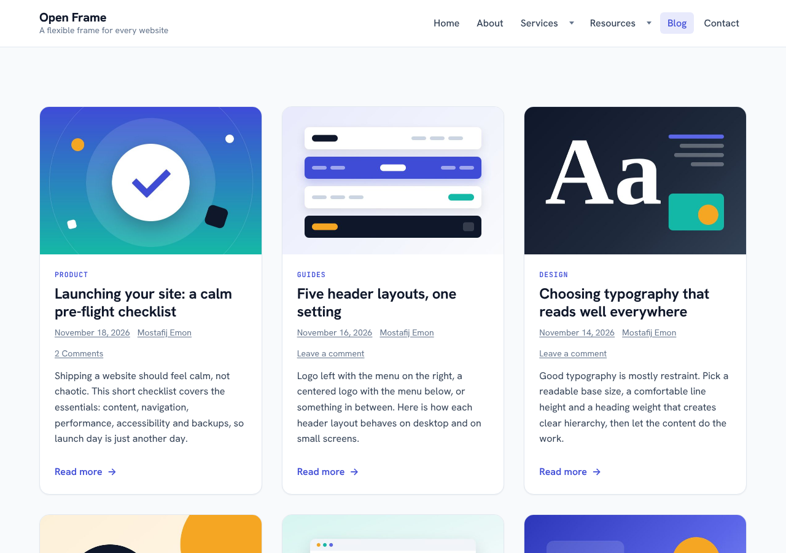

Grid columns reduce automatically: three and four columns become two on tablets, and every grid becomes one column on phones.

## 8. Global Colors

**Customize → Open Frame Options → Global Colors**

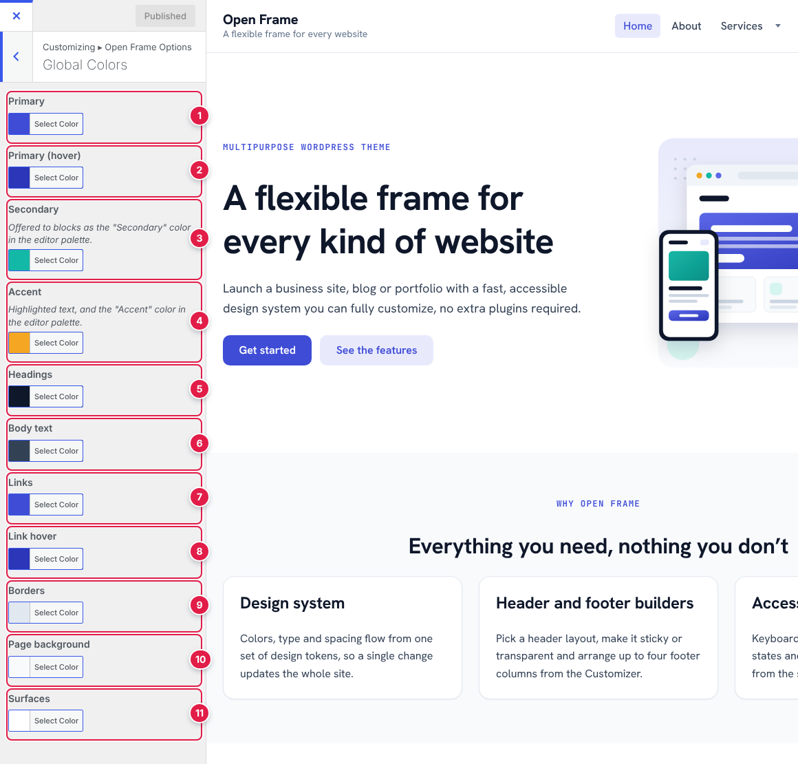

| # | Setting | Default | Used for |
| --- | --- | --- | --- |
| 1 | Primary | `#3f4cd6` | Buttons, active menu items, highlights, the focus outline |
| 2 | Primary (hover) | `#2b36b8` | Buttons on hover |
| 3 | Secondary | `#14b8a6` | The *Secondary* color offered to blocks in the editor palette |
| 4 | Accent | `#f5a623` | Highlighted text, and the *Accent* color in the editor palette |
| 5 | Headings | `#0f172a` | All headings and post titles |
| 6 | Body text | `#334155` | Paragraphs, summaries, form labels |
| 7 | Links | `#3f4cd6` | Links in content |
| 8 | Link hover | `#2b36b8` | Links on hover and keyboard focus |
| 9 | Borders | `#e2e8f0` | Card, table and divider lines |
| 10 | Page background | `#f8fafc` | The page behind the content cards |
| 11 | Surfaces | `#ffffff` | Cards, dropdown menus and form fields |

Click **Select Color** to open the color picker, or type a hex value. The **Default** button next to the picker returns a color to its original value.

Changing a color updates the whole site at once, including the matching swatch in the block editor palette. Soft tints, such as the menu hover background, are calculated from the Primary color automatically.

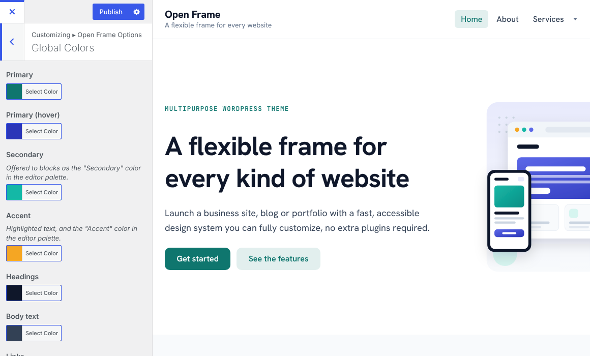


**Choosing readable colors.** Text needs enough contrast with its background. As a rule of thumb, keep *Body text* and *Headings* dark on a light *Surfaces* color, or light on a dark one, and pick a *Primary* color that white button text is readable on.

> WordPress also offers its own **Colors → Background Color** and **Background Image** sections (markers 3 and 4 on the Customizer home screen). When a background color or image is set there, it takes precedence over *Page background*.

## 9. Typography

**Customize → Open Frame Options → Typography**


| # | Setting | Default | Range / choices | What it does |
| --- | --- | --- | --- | --- |
| 1 | Body font | Hanken Grotesk | Hanken Grotesk, System UI, Serif, Monospace | Font for text |
| 2 | Heading font | Hanken Grotesk | Same four choices | Font for headings and post titles |
| 3 | Base font size | 16 px | 14 to 22 | Size of body text |
| 4 | Body line height | 160 % | 120 to 200 | Space between lines of body text |
| 5 | Heading weight | 700 | 400 to 900, in steps of 100 | Thickness of all headings |

The four font choices:

| Choice | Result |
| --- | --- |
| Hanken Grotesk | The bundled sans-serif font, loaded from your own site |
| System UI | The visitor's system font. No font file is downloaded |
| Serif | Georgia, or the system serif font |
| Monospace | JetBrains Mono, the bundled monospaced font |

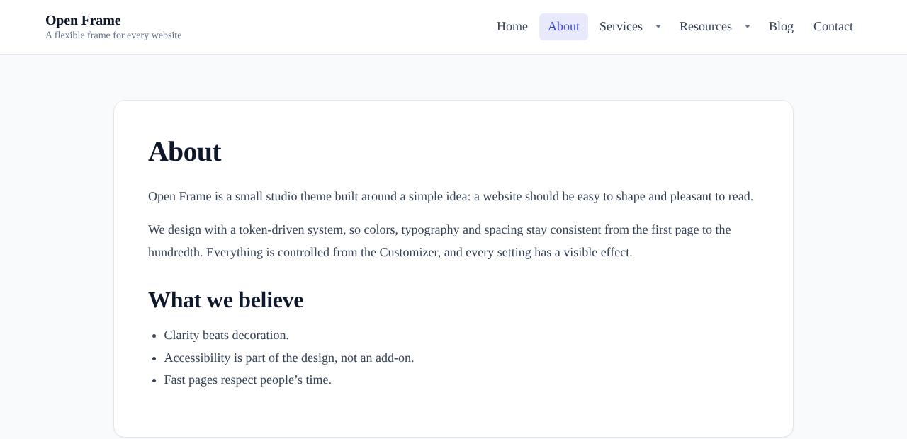

## 10. Header Builder

**Customize → Open Frame Options → Header Builder**

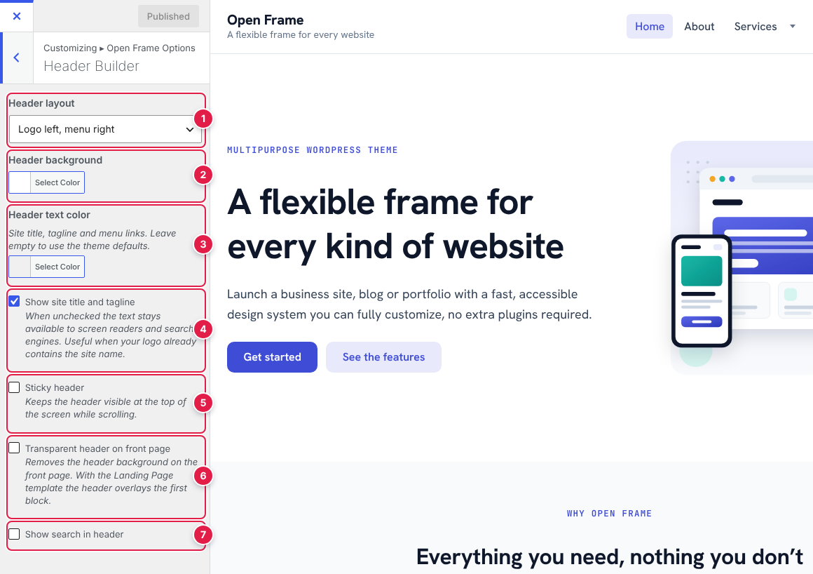

| # | Setting | Default | What it does |
| --- | --- | --- | --- |
| 1 | Header layout | Logo left, menu right | One of five arrangements, shown below |
| 2 | Header background | `#ffffff` | Background color of the header bar and of the mobile menu panel |
| 3 | Header text color | *(empty)* | Color of the site title, tagline and menu links. Leave empty for the theme defaults. Set a light color when you choose a dark header background |
| 4 | Show site title and tagline | On | Turn off when your logo already contains the name. The text stays available to screen readers and search engines |
| 5 | Sticky header | Off | Keeps the header at the top of the screen while scrolling |
| 6 | Transparent header on front page | Off | Removes the header background on the front page. With the Landing Page template the header floats over the first block |
| 7 | Show search in header | Off | Adds a search form to the header |

### The five header layouts

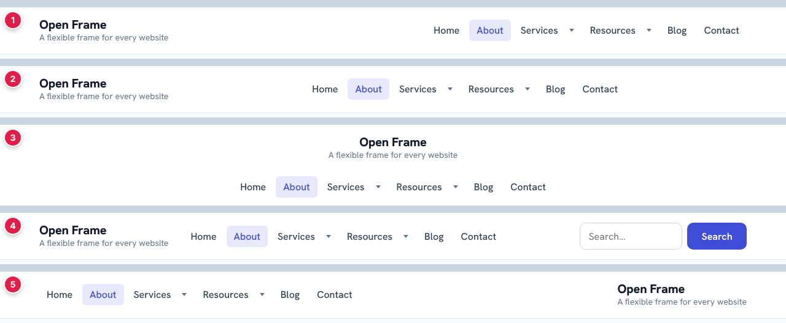

| # | Layout | Description |
| --- | --- | --- |
| 1 | Logo left, menu right | The default. Logo at the start, menu at the end |
| 2 | Logo left, menu centered | Menu centered in the remaining space |
| 3 | Centered logo, menu below | Logo and menu stacked and centered |
| 4 | Logo & menu left | Menu directly after the logo (shown here with the search form) |
| 5 | Logo right, menu left | Mirrored: menu at the start, logo at the end |

On screens narrower than 1024 px the menu collapses into a menu button. The button follows the chosen layout, so layout 5 places it on the left. The search form, when enabled, takes its own row below the logo.

### Sticky header

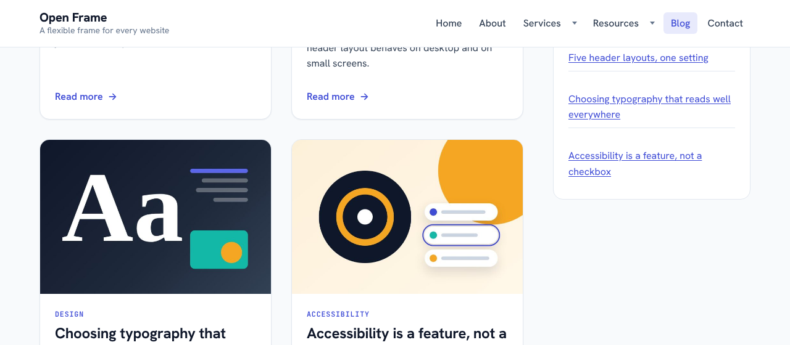

The header stays at the top of the window while the visitor scrolls. For logged-in users it sits just below the WordPress toolbar.

### Transparent header

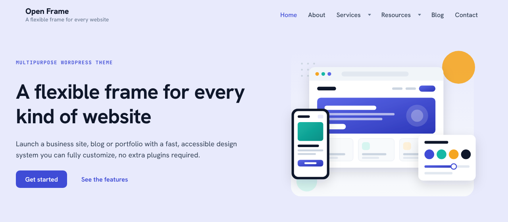

- The option applies to the **front page** only.
- On a page that uses the **Landing Page** template, the header floats over the first block. Give that block enough top padding so its text starts below the header; the hero patterns already do.
- On other front pages the header simply loses its background and border.
- A header that is both **sticky** and **transparent** turns solid as soon as the page is scrolled, so the menu always stays readable.

### A dark header

Set *Header background* to a dark color such as `#0f172a` and *Header text color* to a light color such as `#f8fafc`. The dropdown menus keep the Surfaces color, so their links stay readable, and the mobile menu panel takes the header background.

## 11. Footer Builder

**Customize → Open Frame Options → Footer Builder**


| # | Setting | Default | What it does |
| --- | --- | --- | --- |
| 1 | Show footer widget area | On | Shows or hides the widget columns. The copyright bar always stays |
| 2 | Footer columns | 4 columns | Maximum number of widget columns (1 to 4). Empty widget areas are skipped and the remaining columns share the row |
| 3 | Footer background | `#0f172a` | Background color of the footer |
| 4 | Footer text color | `#cbd5e1` | Color of footer text |
| 5 | Footer heading and link color | `#ffffff` | Color of footer headings and links |
| 6 | Copyright text | *(empty)* | Leave empty for "© Year Site name. All rights reserved." Basic HTML such as links is allowed |

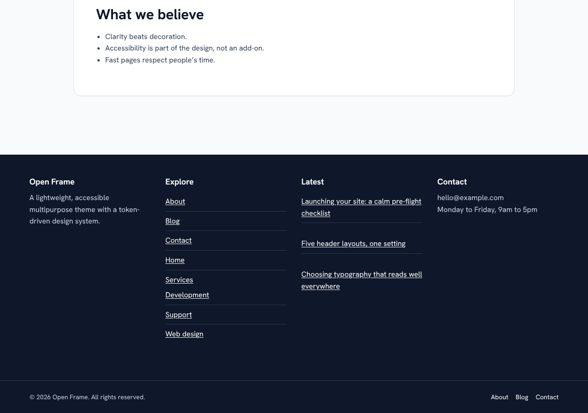

The footer columns are the widget areas **Footer 1** to **Footer 4** (see [Widget areas](#14-widget-areas)). On tablets the columns become two per row, and one per row on phones.

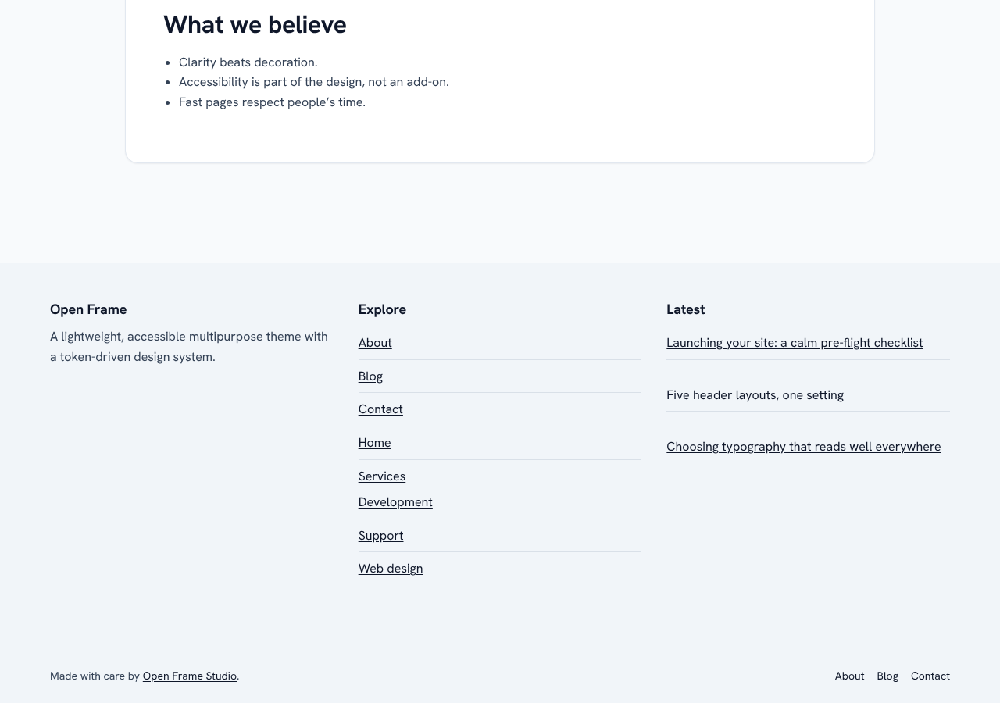

For a light footer, choose a light *Footer background* and dark colors for *Footer text color* and *Footer heading and link color*.

## 12. Building the home page

Open Frame includes a **Landing Page** template: a blank canvas with no page title, no content card and no sidebar. It is made for pages built from blocks.

### Step 1: create the page and choose the template

1. Go to **Pages → Add New** and give the page a title, for example *Home*.
2. In the settings sidebar on the right, click the **Template** value (marker 1) and choose **Landing Page** in the box that opens (marker 2).


### Step 2: insert a pattern

1. Click the **+** button in the top toolbar (marker 1).
2. Switch to the **Patterns** tab (marker 2).
3. Choose the **Open Frame** category (marker 3).
4. Click a pattern in the list (marker 4). **Landing page** inserts a complete home page; the other patterns insert one section each.


Replace the sample text with your own, then click **Publish**.

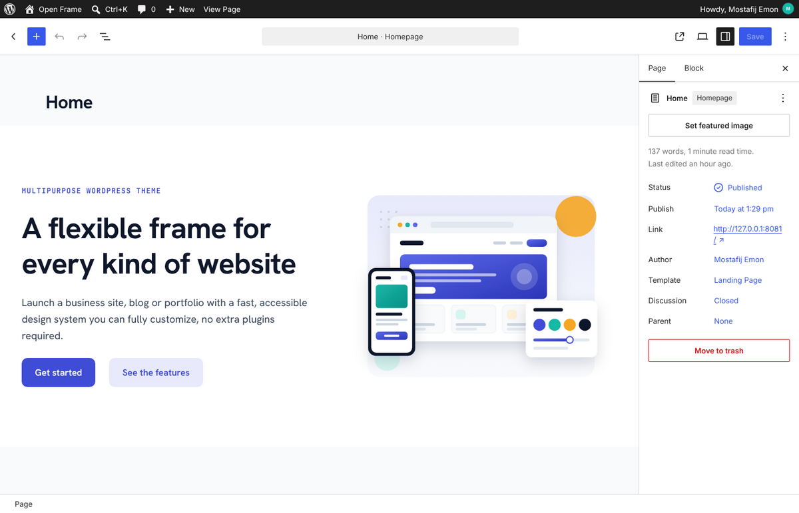

### Step 3: set it as the home page

**Customize → Homepage Settings** (or **Settings → Reading**)

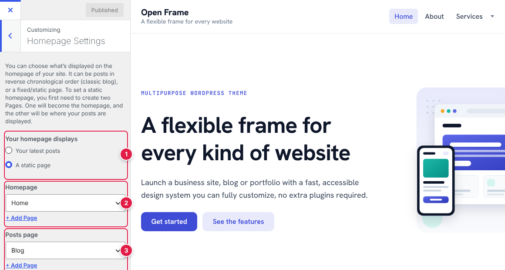

| # | Setting | Choose |
| --- | --- | --- |
| 1 | Your homepage displays | **A static page** |
| 2 | Homepage | The page you just built |
| 3 | Posts page | An empty page, for example *Blog*, that will list your posts |

### How blocks are sized on the Landing Page template

| Block alignment | Width |
| --- | --- |
| None (default) | Content width (960 px by default) |
| Wide width | Container width (1200 px by default) |
| Full width | The whole browser window |

On phones every block keeps a comfortable side margin, and full-width blocks still reach both edges.


> **Tip.** The Landing Page template does not print the page title. Each page should still have one main heading, so start with a pattern that includes a Heading 1 (both hero patterns do).

## 13. Menus and the mega menu

Open Frame has two menu locations.

**Appearance → Menus → Manage Locations**

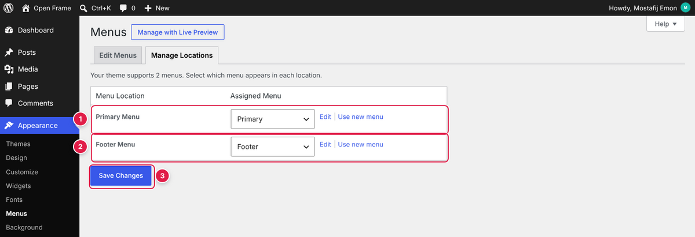

| # | Location | Where it appears |
| --- | --- | --- |
| 1 | Primary Menu | In the header. Supports dropdowns of any depth and the mega menu |
| 2 | Footer Menu | In the copyright bar. One level only |
| 3 | Save Changes | Saves the assignment |

If no Primary Menu is assigned, or the assigned menu is empty, visitors see no menu and administrators see an **Add a menu** link in its place.

### Dropdown menus

On the **Edit Menus** tab, drag a menu item slightly to the right, under another item, to make it a sub-item. Parent items get a small arrow button.

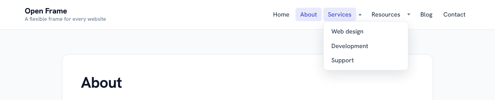

| Input | How it works |
| --- | --- |
| Mouse | Hover the parent item, or click the arrow |
| Keyboard | Press <kbd>Tab</kbd> to reach the arrow button and <kbd>Enter</kbd> or <kbd>Space</kbd> to open it. <kbd>Esc</kbd> closes the menu and returns focus to the button |
| Touch | Tap the arrow to open, tap it again to close |

A dropdown that would run off the edge of the screen opens toward the other side automatically.

### Mega menu

A mega menu shows the sub-items of one menu item as columns in a wide panel. No plugin is needed.

**Step 1.** On the **Menus** screen, open **Screen Options** at the top right (marker 1) and tick **CSS Classes** (marker 2).

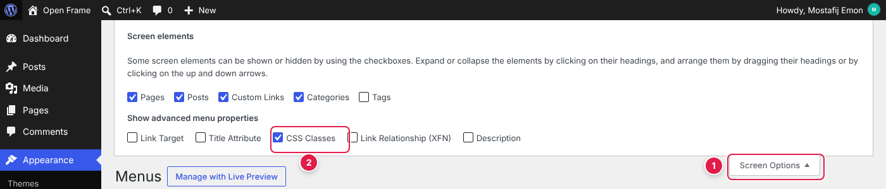

**Step 2.** Build the menu item and type `of-mega` in its **CSS Classes** field.


| # | What it is |
| --- | --- |
| 1 | The top-level item that becomes the mega menu |
| 2 | The **CSS Classes** field with `of-mega` |
| 3 | A direct sub-item: it becomes a **column heading** |
| 4 | An item nested below a column heading: it becomes a **link** in that column |
| 5 | **Save Menu** |

**The result:**


| # | What it is |
| --- | --- |
| 1 | The top-level item with the `of-mega` class |
| 2 | The mega menu panel, as wide as the header container |
| 3 | A column heading |
| 4 | The links of a column |

Items without the `of-mega` class keep the standard dropdown. The mega menu layout applies on screens 1024 px and wider.

### Mobile menu


| # | What it is |
| --- | --- |
| 1 | Logo or site title and tagline |
| 2 | Menu button. Tap to open or close the menu |
| 3 | The menu panel, as wide as the screen |
| 4 | Arrow button of an item with sub-items |
| 5 | An open sub-menu |

The panel closes when a link is followed, when <kbd>Esc</kbd> is pressed or when focus moves out of the menu. Mega menus become ordinary collapsible lists.

## 14. Widget areas

**Appearance → Widgets**


| # | Widget area | Appears on |
| --- | --- | --- |
| 1 | Main Sidebar | Pages and single posts that use a sidebar layout |
| 2 | Blog Sidebar | The blog, archives and search results |
| 3 | Footer 1 | First footer column |
| 4 | Footer 2 | Second footer column |
| 5 | Footer 3 | Third footer column |
| 6 | Footer 4 | Fourth footer column |
| 7 | **+** | Adds a block to the selected widget area |
| 8 | Update | Saves your widgets |

How to add a widget: click a widget area to open it, click **+** inside it, choose a block (for example *Heading*, *Paragraph*, *Latest Posts*, *Categories* or *Search*) and click **Update**.

Good to know:

- Start each widget with a **Heading** block to give it a title.
- Empty areas are never shown. A sidebar layout with an empty sidebar falls back to a centered column, and the footer only prints the columns that contain widgets.
- Sidebar widgets appear as white cards; footer widgets use the footer colors.

## 15. Page templates

Choose a template in the page editor under **Template** (see [Building the home page](#12-building-the-home-page)).

| Template | Description |
| --- | --- |
| Default template | Title and content in a card. Uses the *Default page layout* from the Customizer (No sidebar by default) |
| Full Width | The same card stretched to the container width, never with a sidebar |
| Landing Page | Blank canvas with no title, card or sidebar |

Wide and full-width blocks inside the standard card:

- In the **No sidebar** and **Full width** layouts, a *Wide width* block grows out of the card up to the container width, and a *Full width* block stretches across the whole window.
- Next to a sidebar, a *Full width* block stretches to the edges of the content card and a *Wide width* block reaches halfway into its padding, so neither runs under the sidebar.

Other views included with the theme:


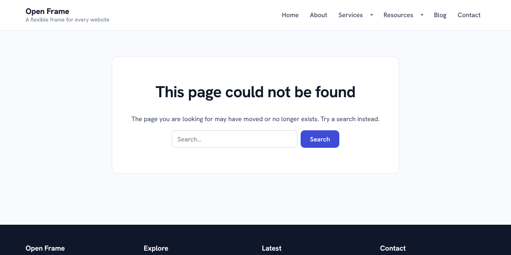

## 16. Blog and posts

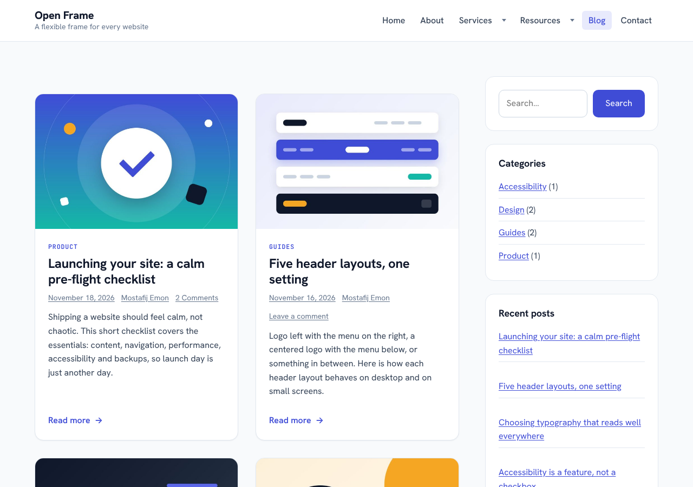

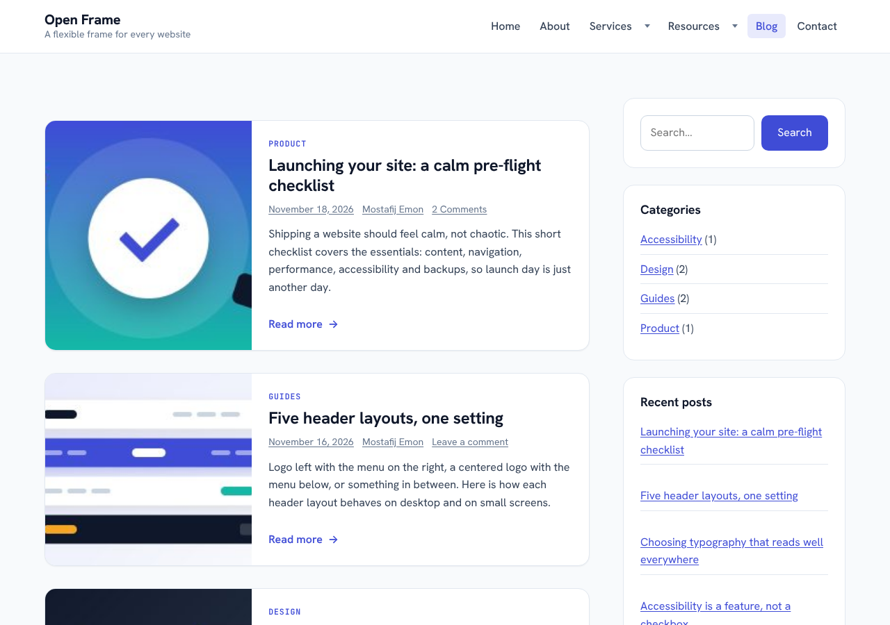

| Feature | How it works |
| --- | --- |
| Listing style | List or Grid, with 2 to 4 columns for the grid (Layout settings 5 and 6) |
| Featured images | Add one under **Featured image** in the post editor. Listings use a 720 × 480 px crop and single posts a 1200 × 630 px crop, so upload images at least 1200 px wide |
| Category label | The first category of the post is shown above the title |
| Excerpts | The summary is the post's excerpt, or the first words of the post. Set the length in Layout → *Excerpt length* |
| Sticky posts | A sticky post gets a highlighted border and a **Featured** badge on the first page of the blog |
| Pagination | Numbered page links below the listing |


Comments support threaded replies. The reply form opens directly under the comment being answered, and a comment that is waiting for approval is shown to its author with a notice.

## 17. Block editor features

The editor uses the same fonts and colors as the front of the site, so what you see while writing matches the published page.

### Patterns

| Pattern | Description |
| --- | --- |
| Hero | Centered headline, text and two buttons |
| Hero with illustration | Two columns with a headline, buttons and an illustration |
| Feature cards | A section heading and three cards |
| Latest posts grid | A section heading and the three most recent posts |
| Call to action | A dark full-width band with a headline and a button |
| Landing page | All of the above combined into a complete home page |

### Block styles

Select a block, open the **Styles** panel in the block sidebar and choose:

| Block | Style | Result |
| --- | --- | --- |
| Group | Card | White card with border, rounded corners and a soft shadow |
| Quote | Card | The same card look for quotations |
| Paragraph | Eyebrow | A small uppercase label to place above a heading |
| Button | Soft | A light, tinted button |
| Image | Shadow | Rounded image with a large shadow |

### Colors, sizes and spacing

| Feature | Values |
| --- | --- |
| Palette | Primary, Primary dark, Secondary, Accent, Heading, Body text, Muted, Border, Surface, Background, Dark. The colors that have a Customizer setting follow your choice there |
| Font sizes | Small, Medium, Large, Extra large, Huge, Display |
| Spacing | Seven steps, from 0.5 rem to a fluid 4 to 6 rem |
| Content width | The editor canvas uses your *Content width* and *Container width* settings |

## 18. Fonts

Open Frame bundles two open-source typefaces as variable fonts, loaded from your own server:

| Font | Used for | License |
| --- | --- | --- |
| Hanken Grotesk | Text and headings | SIL Open Font License 1.1 |
| JetBrains Mono | Code, small labels and the Monospace choice | SIL Open Font License 1.1 |

The files cover the Latin and Latin Extended character sets. The browser only downloads a font file when the page actually uses it. Choose **System UI** for both fonts in Typography if you prefer to load no font files at all.

## 19. Customization recipes

Small changes that have no Customizer setting can be made with CSS under **Customize → Additional CSS** (marker 8 on the Customizer home screen). The theme is built on CSS variables, so most changes are one line.

### Squarer or rounder corners

```css
:root {
	--of-radius-md: 4px;   /* Buttons, fields, images */
	--of-radius-lg: 8px;   /* Cards */
}
```

### Flat cards without shadows

```css
:root {
	--of-shadow-sm: none;
	--of-shadow-md: none;
}
```

### A wider or narrower sidebar

```css
@media (min-width: 1024px) {
	.of-layout--right-sidebar.of-layout--has-sidebar { grid-template-columns: minmax(0, 1fr) 380px; }
	.of-layout--left-sidebar.of-layout--has-sidebar { grid-template-columns: 380px minmax(0, 1fr); }
}
```

### A larger logo

```css
.site-branding .custom-logo { max-height: 72px; }
```

### Uppercase menu links

```css
.main-navigation a { text-transform: uppercase; letter-spacing: 0.06em; font-size: 0.875rem; }
```

### Hide the author name in post meta

```css
.entry-meta .byline { display: none; }
```

### Tighter or looser content padding

```css
:root {
	--of-content-padding: 1rem;                         /* Side margins of the container */
	--of-card-padding: clamp(1rem, 0.5rem + 2vw, 2rem); /* Padding inside content cards */
}
```

The full list of variables is in the [developer reference](#21-child-themes-and-developer-reference).

## 20. Accessibility, RTL and translation

**Accessibility**

- A *Skip to content* link is the first stop for keyboard users.
- Menus work with the keyboard and announce their open or closed state to screen readers.
- Every interactive element has a visible focus outline.
- Default colors meet WCAG AA contrast for text.
- Animations are reduced for visitors who ask their system for less motion.
- Without JavaScript the menu is shown fully expanded, so the site stays usable.

**Right-to-left languages**

The stylesheet is written with logical properties, so the layout mirrors automatically for RTL languages such as Arabic and Hebrew. No separate RTL stylesheet is needed.

**Translation**

- Text domain: `open-frame`
- Template file: `languages/open-frame.pot`

Translate the theme with a tool such as Poedit or Loco Translate, and save the files as `open-frame-{locale}.po` and `.mo` (for example `open-frame-de_DE.mo`) in `wp-content/languages/themes/`.

## 21. Child themes and developer reference

### Creating a child theme

Create a folder `wp-content/themes/open-frame-child` containing `style.css`:

```css
/*
Theme Name: Open Frame Child
Template: open-frame
Version: 1.0.0
*/

/* Your CSS here. */
```

Open Frame loads its own stylesheet first and then the child theme's `style.css` automatically. You do not need to enqueue either of them.

### Filters

| Filter | Arguments | Purpose |
| --- | --- | --- |
| `open_frame_layout` | `string $layout` | Change the layout for the current view. Return `right-sidebar`, `left-sidebar`, `no-sidebar` or `full-width` |
| `open_frame_content_width` | `int $width` | Change the global `$content_width` used for embeds and images |

```php
// Use the full-width layout on a custom post type.
add_filter(
	'open_frame_layout',
	function ( $layout ) {
		return is_singular( 'project' ) ? 'full-width' : $layout;
	}
);
```

### Pluggable template tags

These functions are wrapped in `function_exists()` and can be replaced in a child theme: `open_frame_posted_on()`, `open_frame_posted_by()`, `open_frame_entry_meta()`, `open_frame_entry_footer()`, `open_frame_post_thumbnail()` and `open_frame_comment()`.

### Design tokens

The design system is a set of CSS custom properties on `:root` in `style.css`.

| Group | Properties |
| --- | --- |
| Colors | `--of-color-primary`, `--of-color-primary-hover`, `--of-color-secondary`, `--of-color-accent`, `--of-color-heading`, `--of-color-text`, `--of-color-muted`, `--of-color-link`, `--of-color-link-hover`, `--of-color-border`, `--of-color-bg`, `--of-color-surface` |
| Header and footer | `--of-header-bg`, `--of-header-text`, `--of-footer-bg`, `--of-footer-text`, `--of-footer-heading` |
| Typography | `--of-font-body`, `--of-font-heading`, `--of-font-mono`, `--of-fs-body`, `--of-fs-h1` to `--of-fs-h6`, `--of-lh-body`, `--of-fw-heading` |
| Spacing | `--of-space-1` to `--of-space-8`, `--of-section-spacing`, `--of-content-padding`, `--of-card-padding` |
| Shape and depth | `--of-radius-sm`, `--of-radius-md`, `--of-radius-lg`, `--of-radius-pill`, `--of-shadow-sm`, `--of-shadow-md`, `--of-shadow-lg` |
| Layout | `--of-container-wide`, `--of-content-width`, `--of-container-narrow` |

### Customizer settings (theme mods)

| Setting ID | Type | Default |
| --- | --- | --- |
| `open_frame_site_layout` | `full`, `boxed` | `full` |
| `open_frame_container_width` | integer | `1200` |
| `open_frame_content_width` | integer | `960` |
| `open_frame_section_spacing` | integer | `64` |
| `open_frame_blog_style` | `list`, `grid` | `list` |
| `open_frame_blog_columns` | integer | `2` |
| `open_frame_excerpt_length` | integer | `30` |
| `open_frame_blog_layout`, `open_frame_single_layout` | layout | `right-sidebar` |
| `open_frame_page_layout` | layout | `no-sidebar` |
| `open_frame_color_*` (11 settings) | hex color | see [Global Colors](#8-global-colors) |
| `open_frame_body_font`, `open_frame_heading_font` | `hanken`, `system`, `serif`, `mono` | `hanken` |
| `open_frame_base_font_size` | integer | `16` |
| `open_frame_body_line_height` | integer (percent) | `160` |
| `open_frame_heading_weight` | integer | `700` |
| `open_frame_header_layout` | header layout | `logo-left-menu-right` |
| `open_frame_header_bg` | hex color | `#ffffff` |
| `open_frame_header_text` | hex color | *(empty)* |
| `open_frame_show_site_title` | boolean | `true` |
| `open_frame_sticky_header`, `open_frame_transparent_header`, `open_frame_header_search` | boolean | `false` |
| `open_frame_footer_visible` | boolean | `true` |
| `open_frame_footer_layout` | `1-col` to `4-col` | `4-col` |
| `open_frame_footer_bg`, `open_frame_footer_text`, `open_frame_footer_heading` | hex color | `#0f172a`, `#cbd5e1`, `#ffffff` |
| `open_frame_copyright_text` | HTML | *(empty)* |

### Body classes

| Class | When |
| --- | --- |
| `layout-right-sidebar`, `layout-left-sidebar`, `layout-no-sidebar`, `layout-full-width` | The layout that is actually rendered |
| `no-sidebar` | No sidebar is displayed |
| `boxed-layout` | Site layout is Boxed |
| `has-sticky-header` | Sticky header is on |
| `has-transparent-header` | Transparent header applies to this view |

### Image sizes

| Name | Size | Used for |
| --- | --- | --- |
| `open-frame-card` | 720 × 480, cropped | Post cards in listings |
| `open-frame-wide` | 1200 × 630, cropped | Featured image on single posts and pages |

### File structure

```
open-frame/
├── style.css               Theme header, design tokens and all frontend CSS
├── theme.json              Editor palette, fonts, sizes, spacing and layout
├── functions.php           Constants and the include loader
├── header.php, footer.php, sidebar.php, searchform.php, comments.php
├── index.php, single.php, page.php, archive.php, search.php, 404.php
├── page-templates/         full-width.php, landing.php
├── template-parts/         content.php, -single, -page, -search, -none
├── patterns/               Block patterns (registered automatically)
├── inc/
│   ├── setup.php           Theme supports, menus, widget areas, image sizes
│   ├── enqueue.php         Styles and scripts
│   ├── template-tags.php   Post meta, thumbnail and comment output
│   ├── template-functions.php   Layout logic, body classes, excerpts
│   ├── header-builder.php  Header settings and output
│   ├── footer-builder.php  Footer settings and output
│   ├── blocks.php          Block styles, pattern category, palette sync
│   ├── class-open-frame-walker-nav-menu.php   Menu arrow buttons
│   └── customizer/         customizer.php, dynamic-css.php, sanitize.php
├── assets/
│   ├── css/editor.css      Block editor styles
│   ├── js/navigation.js    Menu behavior
│   ├── js/customize-preview.js   Customizer live preview
│   ├── fonts/              Bundled fonts and their licenses
│   └── images/             Hero illustration
└── languages/open-frame.pot
```

## 22. Privacy and performance

- **No remote requests.** Fonts, scripts and styles are served from your own site. The theme contains no tracking, analytics or external services.
- **Small footprint.** One stylesheet, one small script for the menu (about 6 KB, no jQuery) and the font files the page uses.
- **No stored personal data.** The theme itself stores and sends no visitor data.

## 23. Troubleshooting and FAQ

**My menu does not appear.**
Assign a menu to the **Primary Menu** location under **Appearance → Menus → Manage Locations**, and make sure the menu contains items.

**The sidebar is missing.**
A sidebar is only shown when its widget area contains widgets and the layout for that kind of page is *Right sidebar* or *Left sidebar*. Pages use *No sidebar* by default; change **Layout → Default page layout**.

**The mega menu shows a normal dropdown.**
Check that the `of-mega` class is on a **top-level** item, and that **CSS Classes** is enabled in Screen Options. The mega menu layout applies on screens 1024 px and wider.

**The transparent header does nothing.**
It applies only to the **front page**. To make the header float over the content, the front page must use the **Landing Page** template.

**My page title is missing.**
The Landing Page template hides the title on purpose. Use the default template for a standard page with a title.

**My color change does not affect the page background.**
A color or image set under **Customize → Colors → Background Color** or **Background Image** takes precedence over *Page background*.

**The "Grid columns" setting is not visible.**
It appears only while *Blog listing style* is set to **Grid**.

**How do I change the copyright text?**
Open **Customize → Open Frame Options → Footer Builder → Copyright text**.

**Does Open Frame need a plugin?**
No. Every feature described here is part of the theme.

**Can I use a page builder?**
Yes. Use the **Landing Page** or **Full Width** template for builder-made pages.

## 24. Changelog, credits and support

### Changelog

See the `== Changelog ==` section of [`readme.txt`](../readme.txt) for the full history.

### Credits and licenses

- **Open Frame** — © 2026 Mostafij Emon, GPL-2.0-or-later.
- **Hanken Grotesk** — © 2021 The Hanken Grotesk Project Authors, SIL Open Font License 1.1.
- **JetBrains Mono** — © 2020 The JetBrains Mono Project Authors, SIL Open Font License 1.1.
- **Hero illustration and screenshot artwork** — original work by the theme author, GPL-2.0-or-later.

### Support

- Source code and issue tracker: <https://github.com/Mostafijemon24/Open-Frame-Theme>
- Author: [Mostafij Emon](https://github.com/Mostafijemon24)
