# Open Frame — Theme Documentation

**Version 1.0.0** · Requires WordPress 6.4+ and PHP 7.4+ · Tested up to WordPress 7.1 · GPL-2.0-or-later

Open Frame is a lightweight, accessibility-minded multipurpose WordPress theme for business sites, blogs and portfolios. Everything is controlled from the Customizer, no plugin is required, and the fonts are bundled so the theme never calls a remote server.

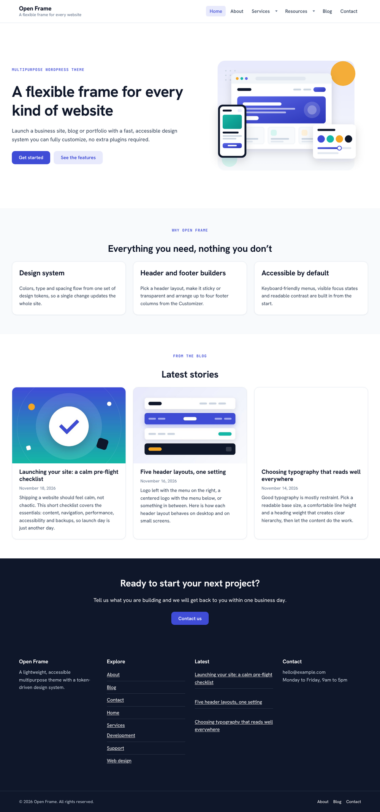

## Contents

1. [Requirements](#1-requirements)
2. [Installation](#2-installation)
3. [Quick start](#3-quick-start)
4. [Building the home page](#4-building-the-home-page)
5. [Customizer reference](#5-customizer-reference)
6. [Menus and the mega menu](#6-menus-and-the-mega-menu)
7. [Widget areas](#7-widget-areas)
8. [Page templates and layouts](#8-page-templates-and-layouts)
9. [Blog and posts](#9-blog-and-posts)
10. [Block editor features](#10-block-editor-features)
11. [Fonts](#11-fonts)
12. [Accessibility, RTL and translation](#12-accessibility-rtl-and-translation)
13. [Child themes and developer reference](#13-child-themes-and-developer-reference)
14. [Privacy and performance](#14-privacy-and-performance)
15. [Troubleshooting and FAQ](#15-troubleshooting-and-faq)
16. [Changelog, credits and support](#16-changelog-credits-and-support)

---

## 1. Requirements

| Item | Requirement |
| --- | --- |
| WordPress | 6.4 or newer (tested up to 7.1) |
| PHP | 7.4 or newer |
| Plugins | None. Open Frame works on its own |
| Browser support | Current versions of Chrome, Edge, Firefox and Safari |

## 2. Installation

### From the WordPress dashboard

1. Go to **Appearance → Themes → Add Theme**.
2. Search for **Open Frame** and click **Install**. If you downloaded the theme as a ZIP file, choose **Upload Theme** and select `open-frame.zip` instead.
3. Click **Activate**.


### Manual installation (SFTP)

1. Unzip `open-frame.zip`.
2. Upload the `open-frame` folder to `wp-content/themes/`.
3. Activate the theme under **Appearance → Themes**.

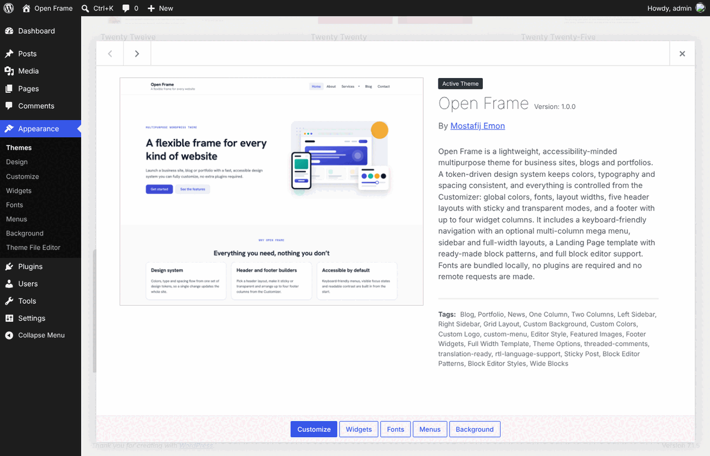

> The theme works immediately after activation. With no menu, no widgets and no settings changed it shows a clean header with your site title, your posts, and a simple copyright bar.

## 3. Quick start

Five steps take a fresh install to a finished site:

1. **Create a menu.** Go to **Appearance → Menus**, create a menu and assign it to **Primary Menu**. See [Menus](#6-menus-and-the-mega-menu).
2. **Set the home page.** Create a page, give it the **Landing Page** template and insert the **Landing page** pattern. Then choose it under **Settings → Reading → A static page**. See [Building the home page](#4-building-the-home-page).
3. **Add widgets.** Go to **Appearance → Widgets** and add blocks to the sidebar and footer areas. See [Widget areas](#7-widget-areas).
4. **Pick your colors and fonts.** Open **Appearance → Customize → Open Frame Options**. See [Customizer reference](#5-customizer-reference).
5. **Add your logo.** In the Customizer, open **Site Identity** and upload a logo (around 180 × 48 px works well; any size is scaled to fit).

## 4. Building the home page

Open Frame includes a **Landing Page** template: a blank canvas with no page title, no content card and no sidebar. It is made for pages built from blocks.

1. Go to **Pages → Add New** and give the page a title, for example *Home*.
2. In the page settings sidebar, click **Template** and choose **Landing Page**.

   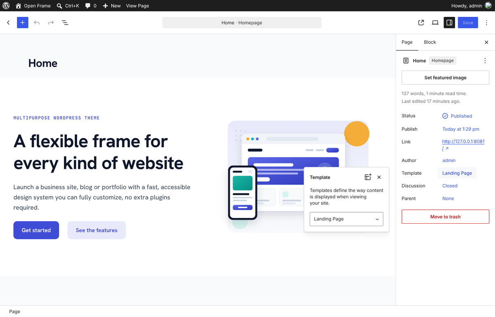

3. Open the block inserter, switch to **Patterns** and choose the **Open Frame** category. Insert the **Landing page** pattern for a complete page, or add sections one by one.

   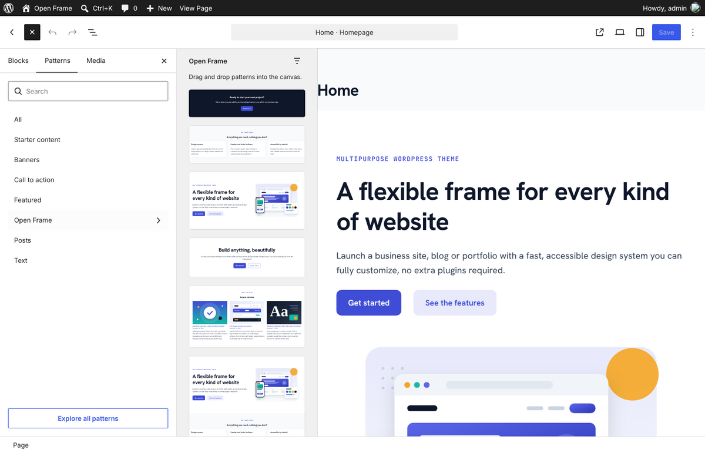

4. Replace the sample text, publish the page, then go to **Settings → Reading**, select **A static page** and choose your page as the **Homepage**. Pick another page (for example *Blog*) as the **Posts page**.

How blocks are sized on the Landing Page template:

| Block alignment | Width |
| --- | --- |
| None (default) | Content width (960 px by default) |
| Wide width | Container width (1200 px by default) |
| Full width | The whole browser window |

On phones every block keeps a comfortable side margin, and full-width blocks still reach both edges.

> **Tip.** The Landing Page template does not print the page title. Each page should still have one main heading, so start with a pattern that includes a Heading 1 (both hero patterns do).

## 5. Customizer reference

All theme settings are under **Appearance → Customize → Open Frame Options**. Every setting has a visible effect, and most changes appear in the preview instantly.

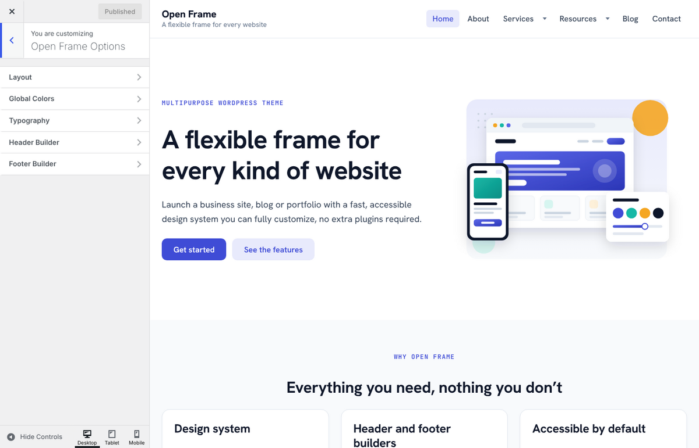

### 5.1 Layout

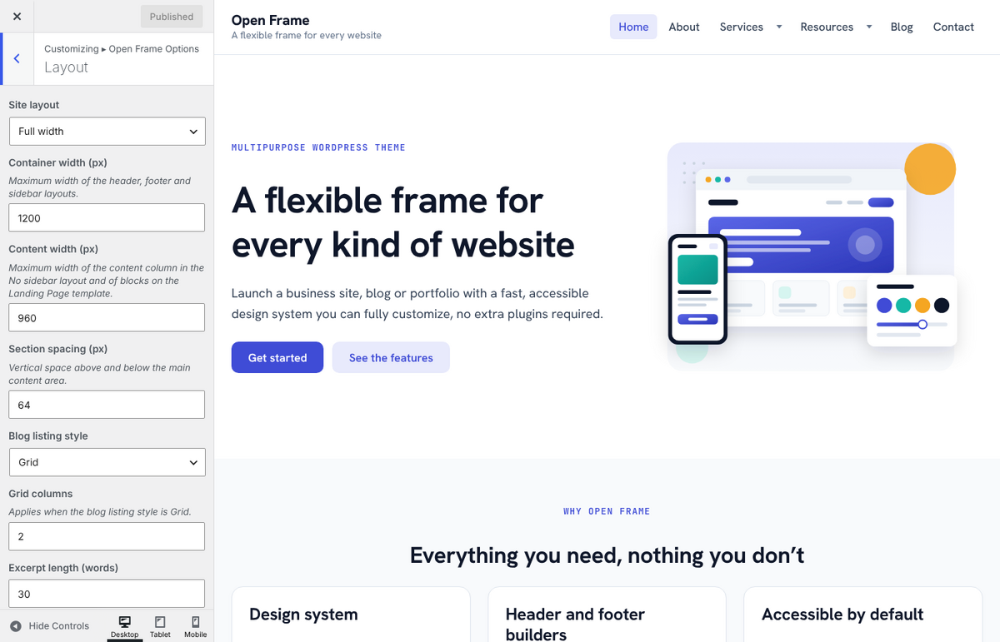

| Setting | Default | What it does |
| --- | --- | --- |
| Site layout | Full width | **Full width** lets the header and footer span the window. **Boxed** places the whole site in a centered box with a shadow |
| Container width | 1200 px | Maximum width of the header, footer and sidebar layouts (800 to 1600) |
| Content width | 960 px | Width of the content column in the *No sidebar* layout, and of default blocks on the Landing Page template (600 to 1400) |
| Section spacing | 64 px | Space above and below the main content area (16 to 160) |
| Blog listing style | List | **List** shows the image beside the text. **Grid** shows cards in columns |
| Grid columns | 2 | Number of columns for the Grid style (2 to 4). Shown only when the style is Grid |
| Excerpt length | 30 words | Length of post summaries in listings (5 to 80) |
| Blog / archive layout | Right sidebar | Layout of the blog, category, tag, author, date and search pages |
| Single post layout | Right sidebar | Layout of single posts |
| Default page layout | No sidebar | Layout of pages that use the default template |

The four layout choices are:

- **Right sidebar** and **Left sidebar**: content with a 320 px sidebar. If the sidebar has no widgets, the content is centered at the content width instead of leaving an empty column.
- **No sidebar (content width)**: a single centered column.
- **Full width (container width)**: a single column that fills the container.

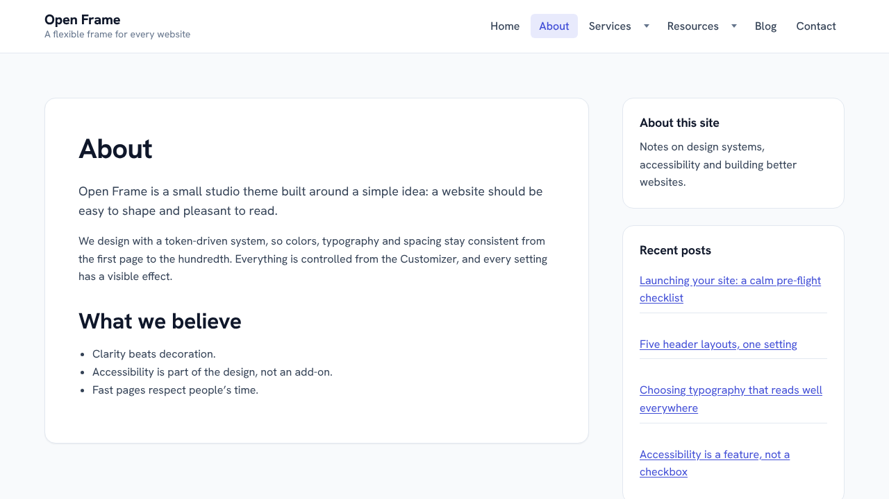

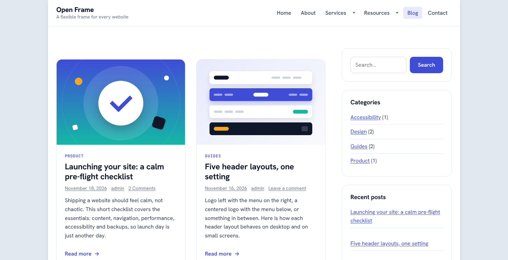

### 5.2 Global Colors


| Setting | Default | Used for |
| --- | --- | --- |
| Primary | `#3f4cd6` | Buttons, active menu items, highlights, focus outline |
| Primary (hover) | `#2b36b8` | Button hover state |
| Secondary | `#14b8a6` | Secondary palette color for blocks |
| Accent | `#f5a623` | Accent palette color for blocks |
| Headings | `#0f172a` | All headings and post titles |
| Body text | `#334155` | Paragraph text |
| Links | `#3f4cd6` | Links in content |
| Link hover | `#2b36b8` | Links on hover and focus |
| Borders | `#e2e8f0` | Card, table and divider lines |
| Page background | `#f8fafc` | The page behind the content cards |
| Surfaces | `#ffffff` | Cards, dropdown menus and form fields |

Changing a color updates the whole site at once, including the matching swatch in the block editor palette. Soft tints (such as the menu hover background) are calculated from the Primary color automatically.


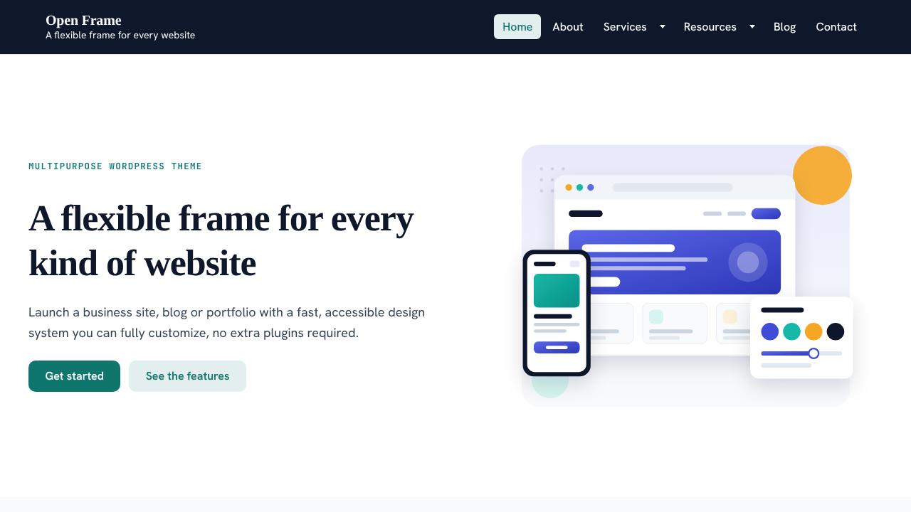

> WordPress also offers **Background** settings (color and image) in the Customizer. When a background color or image is set there, it takes precedence over *Page background*.

### 5.3 Typography

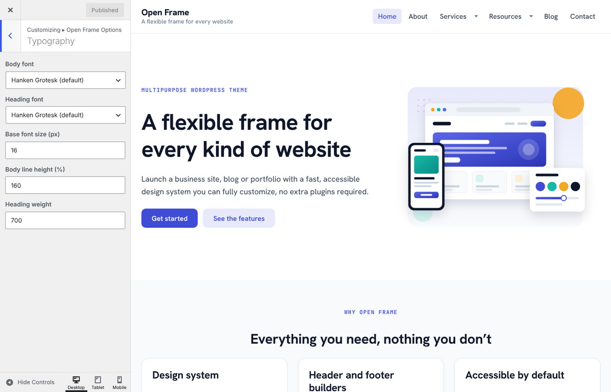

| Setting | Default | What it does |
| --- | --- | --- |
| Body font | Hanken Grotesk | Font for text. Choices: Hanken Grotesk, System UI, Serif, Monospace |
| Heading font | Hanken Grotesk | Font for headings. Same choices |
| Base font size | 16 px | Size of body text (14 to 22) |
| Body line height | 160 % | Line spacing of body text (120 to 200) |
| Heading weight | 700 | Thickness of headings (400 to 900) |

### 5.4 Header Builder


| Setting | Default | What it does |
| --- | --- | --- |
| Header layout | Logo left, menu right | One of five arrangements, shown below |
| Header background | `#ffffff` | Background color of the header bar and the mobile menu panel |
| Header text color | *(empty)* | Color of the site title, tagline and menu links. Leave empty for the theme defaults. Set a light color when you choose a dark header background |
| Show site title and tagline | On | Turn off when your logo already contains the name. The text stays available to screen readers and search engines |
| Sticky header | Off | Keeps the header at the top of the screen while scrolling |
| Transparent header on front page | Off | Removes the header background on the front page. With the Landing Page template the header floats over the first block |
| Show search in header | Off | Adds a search form to the header |

The five header layouts, from top to bottom: *Logo left, menu right* · *Logo left, menu centered* · *Centered logo, menu below* · *Logo & menu left* (shown with the search form) · *Logo right, menu left*.


Notes:

- On screens narrower than 1024 px the menu collapses into a menu button. The button follows the chosen layout, so *Logo right, menu left* places it on the left.
- A header that is both **sticky** and **transparent** turns solid as soon as the page is scrolled, so the menu always stays readable.
- With the transparent header on a Landing Page, give the first block enough top padding so its text starts below the header. The hero patterns already do.

### 5.5 Footer Builder

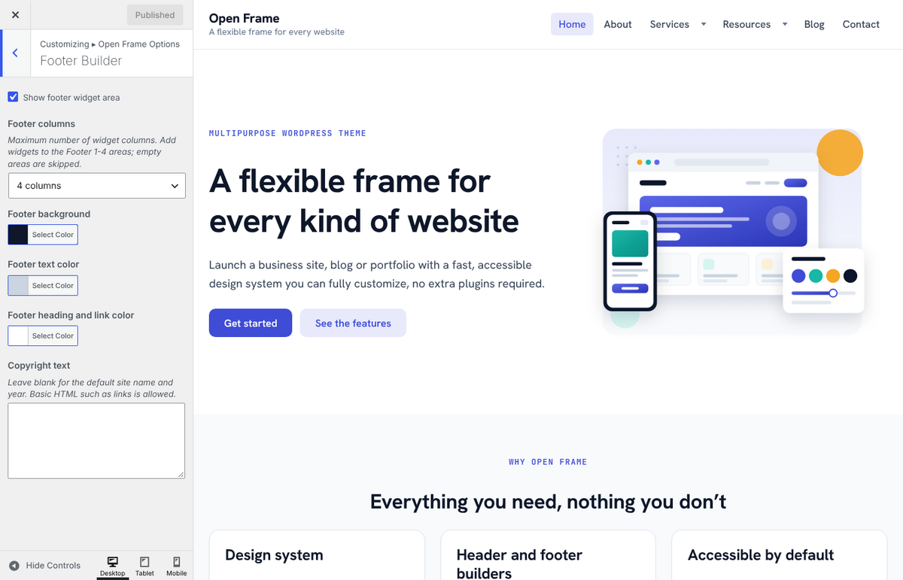

| Setting | Default | What it does |
| --- | --- | --- |
| Show footer widget area | On | Shows or hides the widget columns. The copyright bar always stays |
| Footer columns | 4 columns | Maximum number of widget columns (1 to 4). Empty widget areas are skipped and the remaining columns share the row |
| Footer background | `#0f172a` | Background color of the footer |
| Footer text color | `#cbd5e1` | Color of footer text |
| Footer heading and link color | `#ffffff` | Color of footer headings and links |
| Copyright text | *(empty)* | Leave empty for "© Year Site name. All rights reserved." Basic HTML such as links is allowed |


## 6. Menus and the mega menu

Open Frame has two menu locations, managed under **Appearance → Menus**.

| Location | Where it appears |
| --- | --- |
| Primary Menu | In the header. Supports dropdowns of any depth and the mega menu |
| Footer Menu | In the copyright bar. One level only |


If no Primary Menu is assigned, visitors simply see no menu, and administrators see an **Add a menu** link in its place.

### Dropdown menus

Drag a menu item slightly to the right, under another item, to make it a sub-item. Parent items get a small arrow button.


- **Mouse:** hover the parent item, or click the arrow.
- **Keyboard:** press <kbd>Tab</kbd> to reach the arrow button and <kbd>Enter</kbd> or <kbd>Space</kbd> to open it. <kbd>Esc</kbd> closes the menu and returns focus to the button.
- **Touch:** tap the arrow.

### Mega menu

A mega menu shows the sub-items of one menu item as columns in a wide panel. No plugin is needed.

1. On the **Menus** screen, open **Screen Options** (top right) and tick **CSS Classes**.
2. Open the top-level item that should become a mega menu and type `of-mega` in the **CSS Classes** field.
3. Give that item sub-items. Each direct sub-item becomes a **column heading**; items nested below it become the **links** in that column.
4. Save the menu.

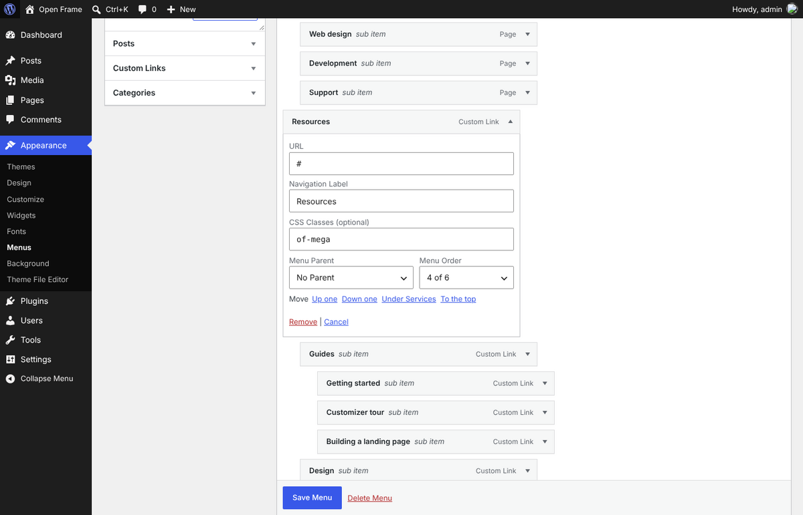

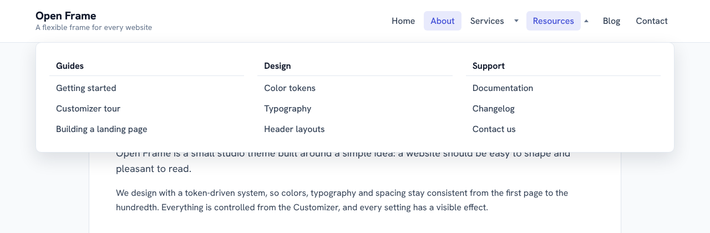

### Mobile menu

Below 1024 px the menu opens as a full-width panel under the header. Sub-menus (including mega menus) become collapsible lists that open with their arrow buttons.

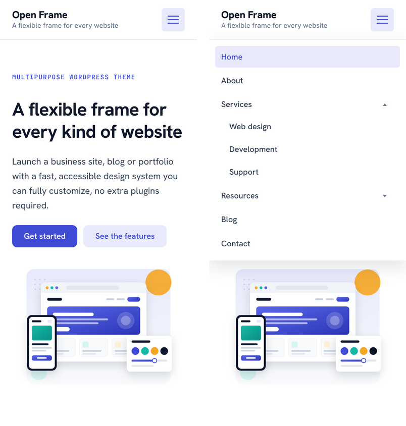

## 7. Widget areas

Add blocks to widget areas under **Appearance → Widgets**.

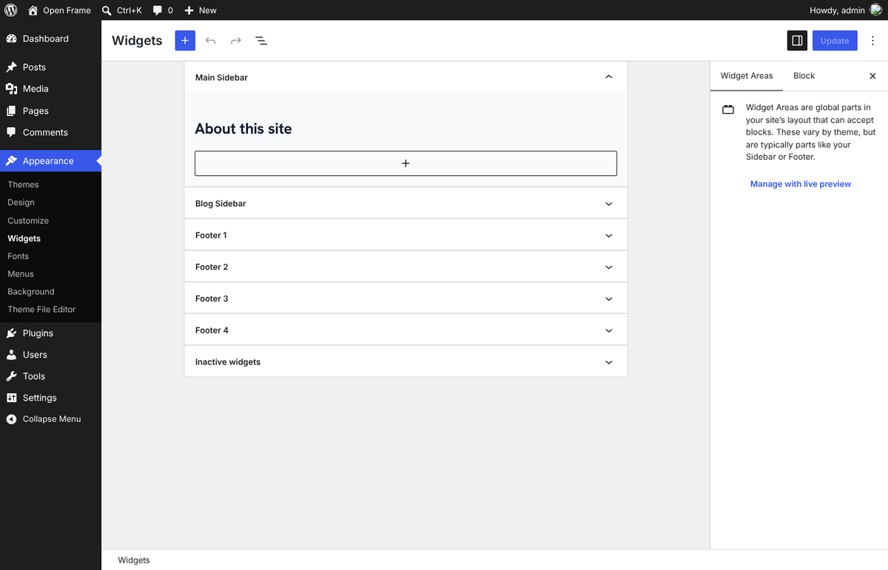

| Widget area | Appears on |
| --- | --- |
| Main Sidebar | Pages and single posts that use a sidebar layout |
| Blog Sidebar | The blog, archives and search results |
| Footer 1 to Footer 4 | Footer columns, from left to right |

Empty areas are never shown. A sidebar layout with an empty sidebar falls back to a centered column, and the footer only prints the columns that contain widgets.

## 8. Page templates and layouts

Choose a template in the page editor under **Template**.

| Template | Description |
| --- | --- |
| Default template | Title and content in a card. Uses the *Default page layout* from the Customizer (No sidebar by default) |
| Full Width | The same card stretched to the container width, never with a sidebar |
| Landing Page | Blank canvas with no title, card or sidebar. See [Building the home page](#4-building-the-home-page) |

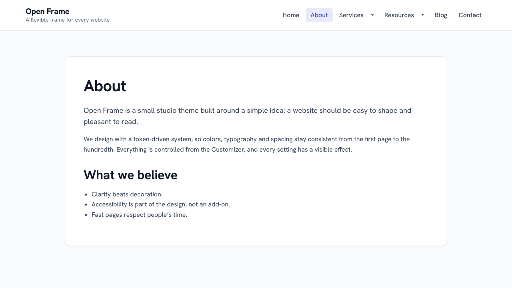

Wide and full-width blocks inside the standard card:

- In the **No sidebar** and **Full width** layouts, a *Full width* block stretches across the whole window.
- Next to a sidebar, a *Full width* block stretches to the edges of the content card, so it never runs under the sidebar.

Other templates included with the theme:

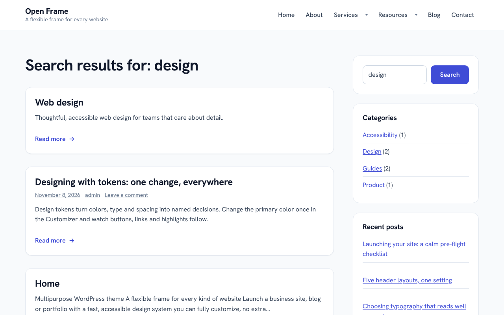


## 9. Blog and posts


- **Listing style:** List or Grid, with 2 to 4 columns for the grid. Grid columns reduce automatically on tablets and phones.
- **Featured images:** add one under **Featured image** in the post editor. Listings use a 720 × 480 px crop and single posts a 1200 × 630 px crop, so upload images at least 1200 px wide.
- **Sticky posts:** a sticky post gets a highlighted border and a **Featured** badge on the first page of the blog.
- **Excerpts:** the summary is the post's excerpt, or the first words of the post. Set the length in **Layout → Excerpt length**.

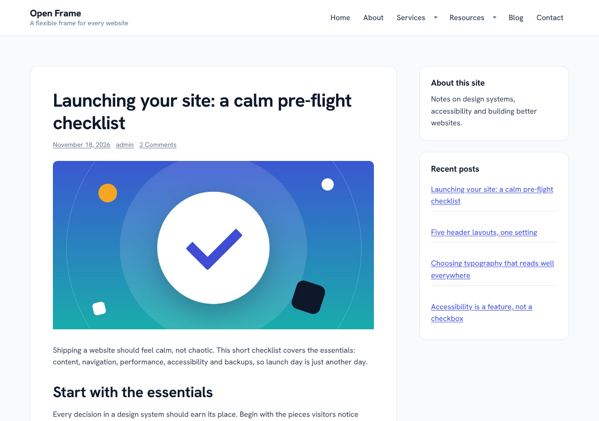

Single posts show the title, date, author, comment link, featured image, content, categories and tags, links to the previous and next post, and the comments.

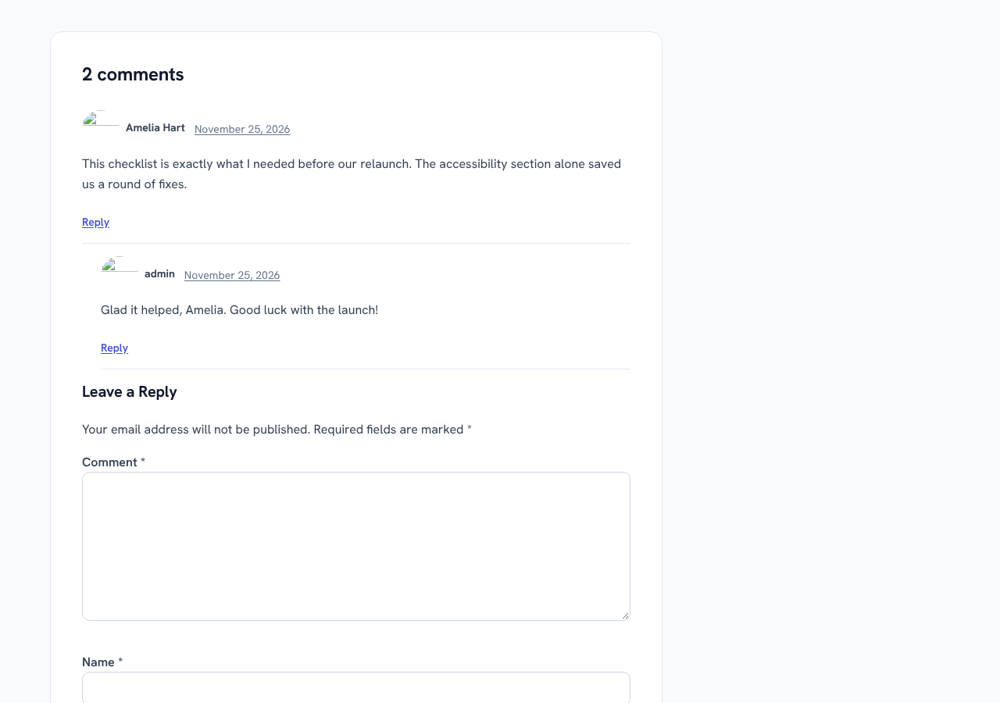

## 10. Block editor features

The editor uses the same fonts and colors as the front of the site, so what you see while writing matches the published page.


### Patterns

| Pattern | Description |
| --- | --- |
| Hero | Centered headline, text and two buttons |
| Hero with illustration | Two columns with a headline, buttons and an illustration |
| Feature cards | A section heading and three cards |
| Latest posts grid | A section heading and the three most recent posts |
| Call to action | A dark full-width band with a headline and a button |
| Landing page | All of the above combined into a complete home page |

### Block styles

Select a block, open the **Styles** panel in the block sidebar and choose:

| Block | Style | Result |
| --- | --- | --- |
| Group | Card | White card with border, rounded corners and a soft shadow |
| Quote | Card | The same card look for quotations |
| Paragraph | Eyebrow | A small uppercase label to place above a heading |
| Button | Soft | A light, tinted button |
| Image | Shadow | Rounded image with a large shadow |

### Colors, sizes and spacing

- **Palette:** Primary, Primary dark, Secondary, Accent, Heading, Body text, Muted, Border, Surface, Background and Dark. The first colors follow your Customizer choices.
- **Font sizes:** Small, Medium, Large, Extra large, Huge and Display.
- **Spacing:** seven steps from 0.5 rem to a fluid 4 to 6 rem.

## 11. Fonts

Open Frame bundles two open-source typefaces as variable fonts, loaded from your own server:

| Font | Used for | License |
| --- | --- | --- |
| Hanken Grotesk | Text and headings | SIL Open Font License 1.1 |
| JetBrains Mono | Code, labels and the Monospace choice | SIL Open Font License 1.1 |

The files cover the Latin and Latin Extended character sets. The browser only downloads a font file when the page actually uses it. Choose **System UI** for both fonts in **Typography** if you prefer to load no font files at all.

## 12. Accessibility, RTL and translation

**Accessibility**

- A *Skip to content* link is the first stop for keyboard users.
- Menus work with the keyboard and announce their open or closed state to screen readers.
- Every interactive element has a visible focus outline.
- Default colors meet WCAG AA contrast for text.
- Animations are reduced for visitors who ask their system for less motion.
- Without JavaScript the menu is shown fully expanded, so the site stays usable.

**Right-to-left languages**

The stylesheet is written with logical properties, so the layout mirrors automatically for RTL languages such as Arabic and Hebrew. No separate RTL stylesheet is needed.

**Translation**

- Text domain: `open-frame`
- Template file: `languages/open-frame.pot`

Translate the theme with a tool such as Poedit or Loco Translate, and save the files as `open-frame-{locale}.po` and `.mo` (for example `open-frame-de_DE.mo`) in `wp-content/languages/themes/`.

## 13. Child themes and developer reference

### Creating a child theme

Create a folder `wp-content/themes/open-frame-child` containing `style.css`:

```css
/*
Theme Name: Open Frame Child
Template: open-frame
Version: 1.0.0
*/

/* Your CSS here. */
```

Open Frame loads its own stylesheet first and then the child theme's `style.css` automatically. You do not need to enqueue either of them.

### Filters

| Filter | Arguments | Purpose |
| --- | --- | --- |
| `open_frame_layout` | `string $layout` | Change the layout for the current view. Return `right-sidebar`, `left-sidebar`, `no-sidebar` or `full-width` |
| `open_frame_content_width` | `int $width` | Change the global `$content_width` used for embeds and images |

```php
// Use the full-width layout on a custom post type.
add_filter(
	'open_frame_layout',
	function ( $layout ) {
		return is_singular( 'project' ) ? 'full-width' : $layout;
	}
);
```

### Pluggable template tags

These functions are wrapped in `function_exists()` and can be replaced in a child theme: `open_frame_posted_on()`, `open_frame_posted_by()`, `open_frame_entry_meta()`, `open_frame_entry_footer()`, `open_frame_post_thumbnail()` and `open_frame_comment()`.

### Design tokens

The design system is a set of CSS custom properties on `:root` in `style.css`. Override them in a child theme or under **Additional CSS**:

```css
:root {
	--of-radius-lg: 8px;      /* Squarer cards */
	--of-container-narrow: 640px;
}
```

| Group | Properties |
| --- | --- |
| Colors | `--of-color-primary`, `--of-color-primary-hover`, `--of-color-secondary`, `--of-color-accent`, `--of-color-heading`, `--of-color-text`, `--of-color-muted`, `--of-color-link`, `--of-color-link-hover`, `--of-color-border`, `--of-color-bg`, `--of-color-surface` |
| Header and footer | `--of-header-bg`, `--of-header-text`, `--of-footer-bg`, `--of-footer-text`, `--of-footer-heading` |
| Typography | `--of-font-body`, `--of-font-heading`, `--of-font-mono`, `--of-fs-body`, `--of-fs-h1` to `--of-fs-h6`, `--of-lh-body`, `--of-fw-heading` |
| Spacing | `--of-space-1` to `--of-space-8`, `--of-section-spacing`, `--of-content-padding`, `--of-card-padding` |
| Shape and depth | `--of-radius-sm`, `--of-radius-md`, `--of-radius-lg`, `--of-radius-pill`, `--of-shadow-sm`, `--of-shadow-md`, `--of-shadow-lg` |
| Layout | `--of-container-wide`, `--of-content-width`, `--of-container-narrow` |

### Body classes

| Class | When |
| --- | --- |
| `layout-right-sidebar`, `layout-left-sidebar`, `layout-no-sidebar`, `layout-full-width` | The layout that is actually rendered |
| `no-sidebar` | No sidebar is displayed |
| `boxed-layout` | Site layout is Boxed |
| `has-sticky-header` | Sticky header is on |
| `has-transparent-header` | Transparent header applies to this view |

### Image sizes

| Name | Size | Used for |
| --- | --- | --- |
| `open-frame-card` | 720 × 480, cropped | Post cards in listings |
| `open-frame-wide` | 1200 × 630, cropped | Featured image on single posts and pages |

### File structure

```
open-frame/
├── style.css               Theme header, design tokens and all frontend CSS
├── theme.json              Editor palette, fonts, sizes, spacing and layout
├── functions.php           Constants and the include loader
├── header.php, footer.php, sidebar.php, searchform.php, comments.php
├── index.php, single.php, page.php, archive.php, search.php, 404.php
├── page-templates/         full-width.php, landing.php
├── template-parts/         content.php, -single, -page, -search, -none
├── patterns/               Block patterns (registered automatically)
├── inc/
│   ├── setup.php           Theme supports, menus, widget areas, image sizes
│   ├── enqueue.php         Styles and scripts
│   ├── template-tags.php   Post meta, thumbnail and comment output
│   ├── template-functions.php   Layout logic, body classes, excerpts
│   ├── header-builder.php  Header settings and output
│   ├── footer-builder.php  Footer settings and output
│   ├── blocks.php          Block styles, pattern category, palette sync
│   ├── class-open-frame-walker-nav-menu.php   Menu arrow buttons
│   └── customizer/         customizer.php, dynamic-css.php, sanitize.php
├── assets/
│   ├── css/editor.css      Block editor styles
│   ├── js/navigation.js    Menu behavior
│   ├── js/customize-preview.js   Customizer live preview
│   ├── fonts/              Bundled fonts and their licenses
│   └── images/             Hero illustration
└── languages/open-frame.pot
```

## 14. Privacy and performance

- **No remote requests.** Fonts, scripts and styles are served from your own site. The theme contains no tracking, analytics or external services.
- **Small footprint.** One stylesheet, one small script for the menu (about 4 KB, no jQuery) and the font files the page uses.
- **No stored personal data.** The theme itself stores and sends no visitor data.

## 15. Troubleshooting and FAQ

**My menu does not appear.**
Assign a menu to the **Primary Menu** location under **Appearance → Menus → Manage Locations**.

**The sidebar is missing.**
A sidebar is only shown when its widget area contains widgets and the layout for that kind of page is *Right sidebar* or *Left sidebar*. Pages use *No sidebar* by default; change **Layout → Default page layout**.

**The mega menu shows a normal dropdown.**
Check that the `of-mega` class is on a **top-level** item, and that **CSS Classes** is enabled in Screen Options. The mega menu layout applies on screens 1024 px and wider.

**The transparent header does nothing.**
It applies only to the **front page**. To make the header float over the content, the front page must use the **Landing Page** template.

**My page title is missing.**
The Landing Page template hides the title on purpose. Use the default template for a standard page with a title.

**My color change does not affect the page background.**
A color or image set under **Customize → Background** (or **Colors → Background Color**) takes precedence over *Page background*.

**How do I change the copyright text?**
Open **Customize → Open Frame Options → Footer Builder → Copyright text**.

**Does Open Frame need a plugin?**
No. Every feature described here is part of the theme.

**Can I use a page builder?**
Yes. Use the **Landing Page** or **Full Width** template for builder-made pages.

## 16. Changelog, credits and support

### Changelog

See the `== Changelog ==` section of [`readme.txt`](../readme.txt) for the full history.

### Credits and licenses

- **Open Frame** — © 2026 Mostafij Emon, GPL-2.0-or-later.
- **Hanken Grotesk** — © 2021 The Hanken Grotesk Project Authors, SIL Open Font License 1.1.
- **JetBrains Mono** — © 2020 The JetBrains Mono Project Authors, SIL Open Font License 1.1.
- **Hero illustration and screenshot artwork** — original work by the theme author, GPL-2.0-or-later.

### Support

- Source code and issue tracker: <https://github.com/Mostafijemon24/Open-Frame-Theme>
- Author: [Mostafij Emon](https://mostafijemon.live/)
