# Open Frame Starter Sites — User Guide

**Plugin version 0.6.1** · Needs the Open Frame theme 1.1.0 or newer · WordPress 6.8+ and PHP 7.4+ for the designs · GPL-2.0-or-later

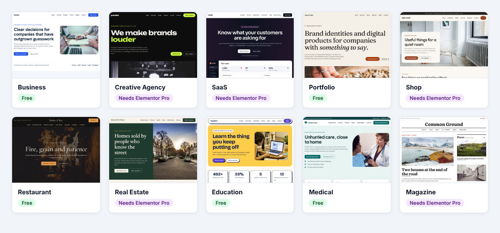

Open Frame Starter Sites is the companion plugin of the [Open Frame theme](README.md). It adds one screen to your dashboard, **Appearance → Starter Sites**, where you choose a complete website design, see what it needs, and import it. Every page of a design is an ordinary Elementor page, so you change texts, pictures and colors the way you would on a page you built yourself. An import can be undone.

**How to read this guide.** Screenshots carry red numbered markers. The table under each screenshot explains every number.

## Contents

1. [What you need](#1-what-you-need)
2. [Installation](#2-installation)
3. [The Starter Sites screen](#3-the-starter-sites-screen)
4. [The ten designs](#4-the-ten-designs)
5. [Looking at a design](#5-looking-at-a-design)
6. [Importing a design](#6-importing-a-design)
7. [After the import: make it yours](#7-after-the-import-make-it-yours)
8. [Header, footer and blog](#8-header-footer-and-blog)
9. [Colors and fonts](#9-colors-and-fonts)
10. [Forms](#10-forms)
11. [The Shop design](#11-the-shop-design)
12. [Rolling back an import](#12-rolling-back-an-import)
13. [History and updates of a design](#13-history-and-updates-of-a-design)
14. [Privacy](#14-privacy)
15. [Troubleshooting](#15-troubleshooting)
16. [Removing the plugin](#16-removing-the-plugin)
17. [Support](#17-support)

---

## 1. What you need

| | Needed | Notes |
| --- | --- | --- |
| **Theme** | Open Frame 1.1.0 or newer, active | A child theme of Open Frame works too |
| **WordPress** | 6.8 or newer | The plugin itself runs on 6.4, but the designs need 6.8 |
| **PHP** | 7.4 or newer | Tested on 7.4, 8.1 and 8.3 |
| **Elementor** | 4.0.3 or newer (free) | The screen installs and activates it for you |
| **Elementor Pro** | 4.0 or newer, only for designs marked "Needs Elementor Pro" | A commercial plugin sold by Elementor. The screen tells you when a design needs it; it never installs it |
| **WooCommerce** | 10.0 or newer, only for the Shop design | The screen installs and activates it for you |
| **Server** | Outgoing HTTPS requests, ZIP support, a writable uploads folder | Standard on ordinary hosting. The screen checks all three |

You need to be an administrator of the site.

> **Try it on a new site first.** An import adds pages and changes your home page and site-wide colors. It deletes nothing and can be rolled back, but on a site that already has visitors, make a backup before you import.

## 2. Installation

1. Install and activate the **Open Frame** theme (see [Installation in the theme guide](README.md#2-installation)).
2. In your dashboard go to **Plugins → Add Plugin → Upload Plugin**, choose `open-frame-starter-sites.zip`, click **Install Now**, then **Activate Plugin**.
3. Go to **Appearance → Starter Sites**.

There is nothing to set up: no account, no licence key, no settings page.

The step-by-step version with checks for the downloaded files is in the [installation guide](INSTALL.md).

## 3. The Starter Sites screen

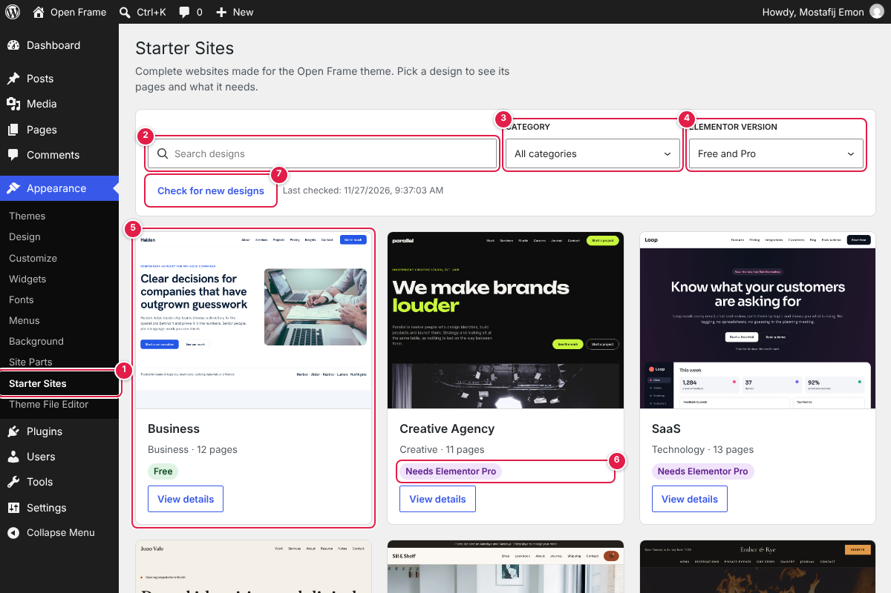

| # | What it is | What you do with it |
| --- | --- | --- |
| 1 | **Appearance → Starter Sites** | Where the screen lives in the dashboard menu |
| 2 | **Search** | Type a word such as "restaurant" or "pricing" to narrow the list |
| 3 | **Category** | Show the designs of one kind: Business, Creative, Technology, Online store, Food and drink, Real estate, Education, Health, Blog and magazine |
| 4 | **Elementor version** | Show only designs for free Elementor, only designs for Elementor Pro, or both |
| 5 | **A design** | A picture of its home page, its name, its category and the number of pages. **View details** opens it |
| 6 | **Badge** | **Free**: works with free Elementor. **Needs Elementor Pro**: needs Elementor Pro. After an import the design also carries **Imported**, and **Update available** when the library has a newer version of it |
| 7 | **Check for new designs** | The list is fetched from the library at most every twelve hours. This button fetches it now. The time of the last check is shown beside it |

Looking through the list and opening designs changes nothing on your site.

## 4. The ten designs

Five designs work with the free version of Elementor. Five need Elementor Pro, because they use its Theme Builder, forms and post lists.

| Design | For | Elementor | Pages |
| --- | --- | --- | --- |
| **Business** | Service companies and consultancies | Free | Home, About, Services, Service Details, Projects, Project Details, Team, Pricing, Insights (blog), Contact |
| **Portfolio** | An independent designer or freelancer | Free | Home, About, Work, Project Details, Services, Service Details, Resume, Notes (blog), Contact |
| **Restaurant** | A restaurant, café or bar (dark design) | Free | Home, Menu, Our Story, Reservations, Private Events, Gallery, Journal (blog), Contact and Location |
| **Education** | An academy or training centre | Free | Home, Courses, Course Details, Instructors, Admissions and Fees, Events, About, News (blog), Contact |
| **Medical** | A clinic or practice | Free | Home, About, Departments, Department Details, Doctors, Doctor Profile, Book an Appointment, Patient Information, Health Notes (blog), Contact |
| **Creative Agency** | A studio or agency (dark design) | Pro | Home, Studio, Services, Service Details, Work, Case Study, Careers, Journal (blog), Contact |
| **SaaS** | A software product | Pro | Home, Features, Feature Details, Pricing, Integrations, Customers, About, Blog, Book a Demo, Privacy, Terms |
| **Real Estate** | An estate agency | Pro | Home, Homes for Sale, Property Details, Agents, Agent Profile, Services, Service Details, About, Market Notes (blog), Contact |
| **Magazine** | A magazine or a blog with sections | Pro | Front Page, Category, Single Article, Author, About, Subscribe, Contact, All Stories |
| **Shop** | A small online store (needs WooCommerce) | Pro | Home, Shop, Product, Cart, Checkout, My Account, About, Lookbook, Shipping and Returns, Journal, Contact |

Every design also brings a header, a footer, a layout for single articles, a "page not found" page, a menu, a few sample articles and its own fonts.

**About the sample content.** Company names, people, prices and texts are invented, and are there to be replaced. The photographs are real and free to use: each one is in the public domain or under the CC0 licence, and the source of every photograph is listed in [`starter-sites/LICENSES.md`](../starter-sites/LICENSES.md). You may keep them on your site, also on a commercial one.

## 5. Looking at a design

Click **View details** on a design.

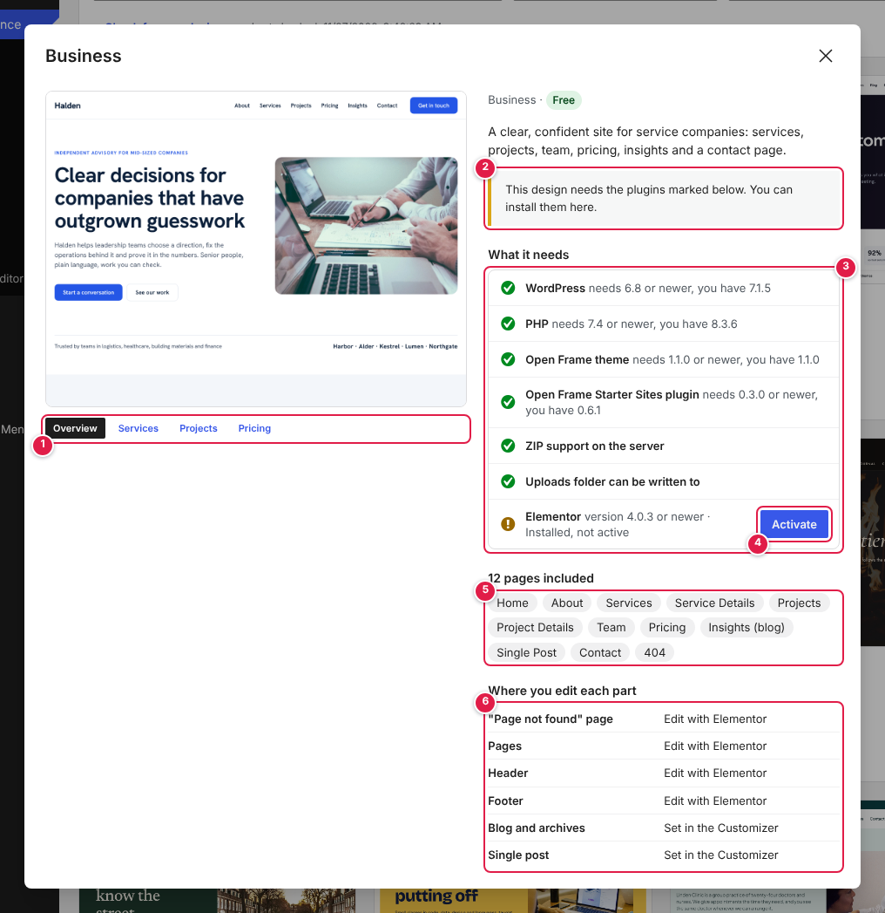

| # | What it is | What it tells you |
| --- | --- | --- |
| 1 | **Preview pictures** | The home page and three more pages of the design. Click a name to switch |
| 2 | **Status** | One sentence about where you stand: what is still missing, or that your site has everything this design needs |
| 3 | **What it needs** | A list with a green tick for everything your site already has: the versions of WordPress and PHP, the theme, this plugin, ZIP support, a writable uploads folder, and the plugins the design is built with |
| 4 | **Install and activate / Activate / Update** | Appears beside a plugin from WordPress.org that is missing, switched off or too old. One click does it, without leaving the screen |
| 5 | **Pages included** | Every page and layout of the design by name |
| 6 | **Where you edit each part** | Which parts are edited with Elementor and which are set in the Customizer |

### When something is missing

- **Elementor or WooCommerce:** click the button beside it (marker 4). WordPress downloads the plugin from WordPress.org with its own installer, the same way as under **Plugins → Add Plugin**.
- **Elementor Pro:** the list says so and links to Elementor's website. Buy it there, install it under **Plugins → Add Plugin → Upload Plugin**, activate your licence, then come back. This plugin does not contain, install or unlock Elementor Pro.
- **WordPress, PHP or the theme is too old:** update it first. For PHP, ask your hosting company.
- **"This server asks for FTP details before it installs plugins":** your host does not let WordPress write plugin files directly. Install the plugin under **Plugins → Add Plugin**, where WordPress asks for those details, then come back.

When every line has a green tick, the status changes and the button **Import this design** appears.

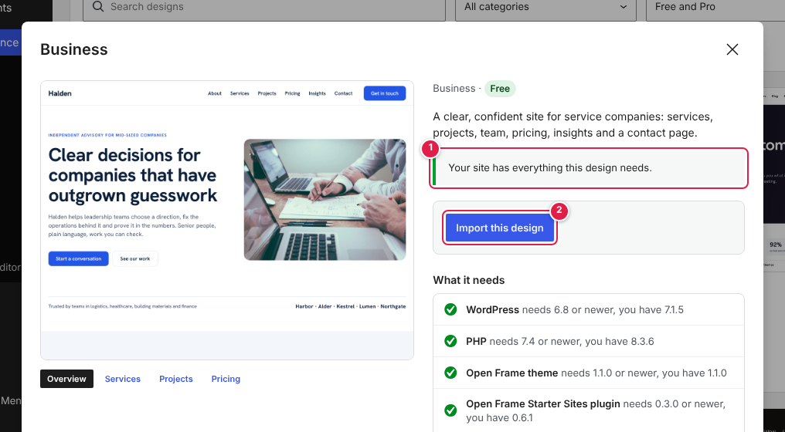

| # | What it is |
| --- | --- |
| 1 | The status now reads "Your site has everything this design needs." |
| 2 | **Import this design** opens the confirmation described in the next chapter |

## 6. Importing a design

### Step 1: read what will change, and confirm

Click **Import this design**. Nothing happens yet: the screen first tells you what an import does.

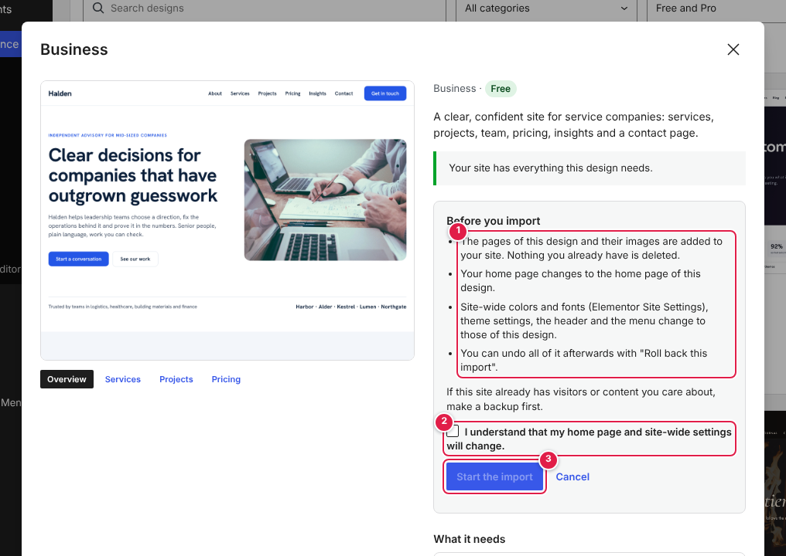

| # | What it is | What it means |
| --- | --- | --- |
| 1 | **Before you import** | Pages and images are **added**. Nothing you already have is deleted. Your **home page** changes to the home page of the design. Site-wide **colors and fonts** (Elementor's Site Settings), some **theme settings**, the **header** and the **menu** change to those of the design |
| 2 | **"I understand…"** | Tick the box to say you have read it. The button stays grey until you do |
| 3 | **Start the import** | Starts it. **Cancel** closes the box and changes nothing |

### Step 2: wait while it runs

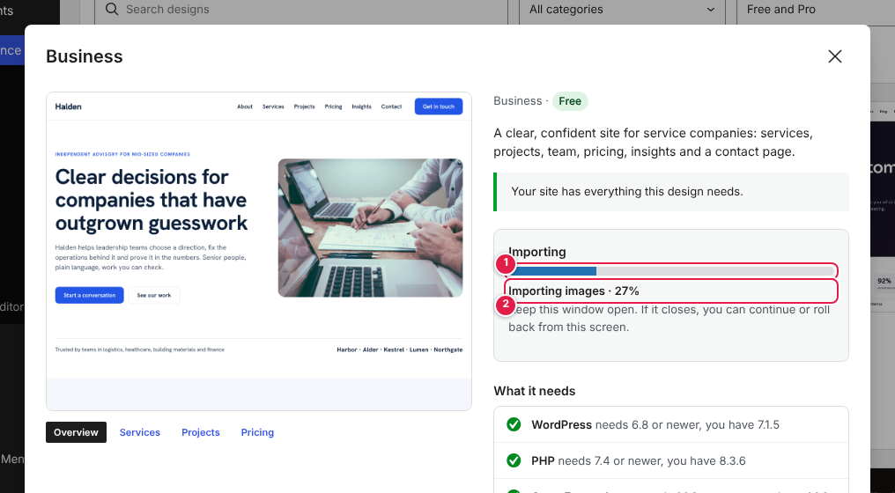

| # | What it is |
| --- | --- |
| 1 | The progress bar |
| 2 | The step that is running now: Checking your site, Saving your current settings, Downloading the design, Importing images, Importing fonts, Creating pages, Setting colors and fonts, Creating menus, Building the pages in Elementor, Applying settings, Finishing |

An import takes between half a minute and a few minutes, depending on your server and on the number of pictures (between 9 and 18 per design). **Keep the window open.**

If the window is closed, the connection drops or your computer goes to sleep, nothing is lost. Open **Appearance → Starter Sites** again: a notice at the top says that an import did not finish, with the link **Continue or roll back**. It opens the design, where **Continue the import** picks up where it stopped and **Roll back this import** takes back what was done so far.

### Step 3: done

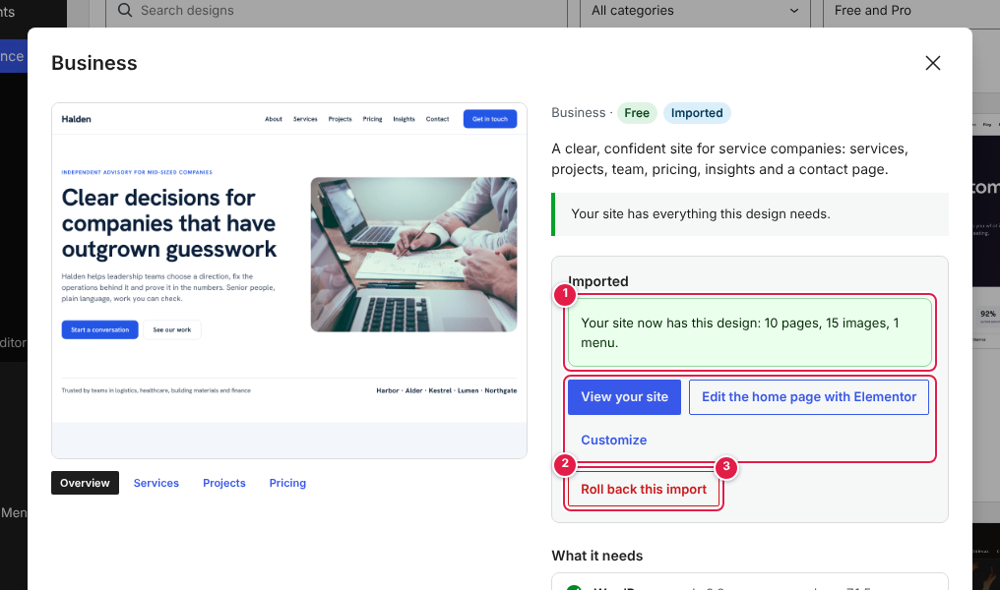

| # | What it is | What you do with it |
| --- | --- | --- |
| 1 | **The result** | How many pages, images and menus were added |
| 2 | **View your site**, **Edit the home page with Elementor**, **Customize** | Three ways to go on from here |
| 3 | **Roll back this import** | Takes the import back. See [Rolling back an import](#12-rolling-back-an-import) |

This is the home page of the Business design a moment after the import:

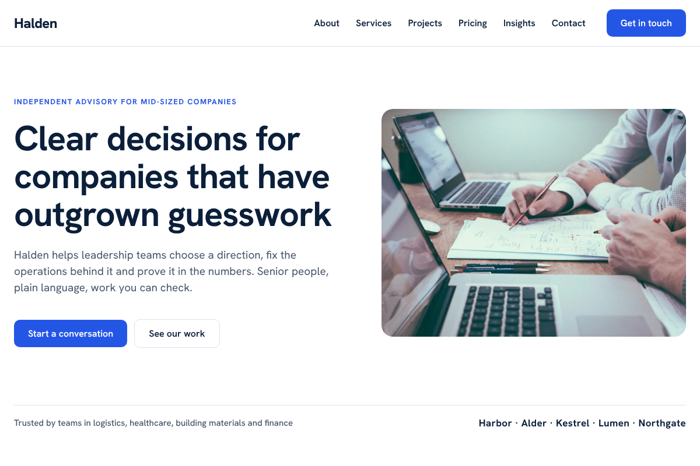

### Importing a second time

- **The same design again:** no page is created twice. The pages of the design are put back the way they came from the library, so **changes you made to those pages are overwritten**. Do this only when you want a fresh copy.
- **A different design:** its pages are added beside the ones you have, and the home page, colors, fonts, header and menu change to the new design. The pages of the earlier design stay on your site until you delete them under **Pages**. If you only want to compare designs, roll back the first one before you import the next.

## 7. After the import: make it yours

Everything a design brought is now ordinary content of your site.

### Edit a page

Go to **Pages**, point at a page and click **Edit with Elementor** (or use **Edit the home page with Elementor** right after the import).

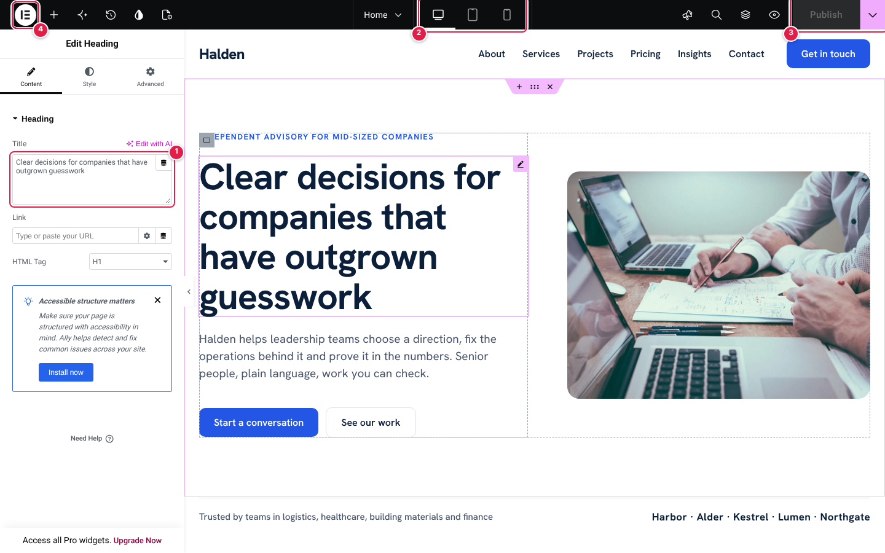

| # | What it is | What you do with it |
| --- | --- | --- |
| 1 | **The settings of what you clicked** | Click any text, picture or button on the page. Its settings open on the left: type a new text, choose another picture, change a link |
| 2 | **Desktop, tablet, phone** | Shows the page as it looks at each size. The designs are prepared for all three; check them after larger changes |
| 3 | **Publish** | Saves your changes and puts them on the site |
| 4 | **Elementor menu** | Opens a menu with **Site Settings** (colors and fonts of the whole site) and, with Elementor Pro, **Theme Builder** |

### A checklist for replacing the sample content

1. **Site name and logo:** **Appearance → Customize → Site Identity**. The header of a design shows your site title; add a logo there if you have one.
2. **Texts:** go through every page under **Pages** and replace the invented names, prices, addresses, telephone numbers and email addresses with your own.
3. **Pictures:** click a picture in Elementor and choose your own from the media library. Give every picture a short description under "Alt text"; people who use a screen reader depend on it.
4. **Articles:** the design brought a few sample articles under **Posts**. Replace or delete them.
5. **Menu:** **Appearance → Menus**. Remove entries for pages you do not use.
6. **Pages you do not need:** move them to the trash under **Pages**. Check afterwards that no button still links to them.
7. **Contact details in the footer:** see the next chapter.
8. **Legal pages:** a privacy policy and, where your country asks for one, an imprint. The designs do not write these for you (the "Privacy" and "Terms" pages of the SaaS design are placeholders with sample text).

## 8. Header, footer and blog

Where you edit these depends on whether the design is for free Elementor or for Elementor Pro.

### Designs for free Elementor: Site Parts

Business, Portfolio, Restaurant, Education and Medical store their header, footer and "page not found" page as **Site Parts**. Go to **Appearance → Site Parts**, point at a part and click **Edit with Elementor**.

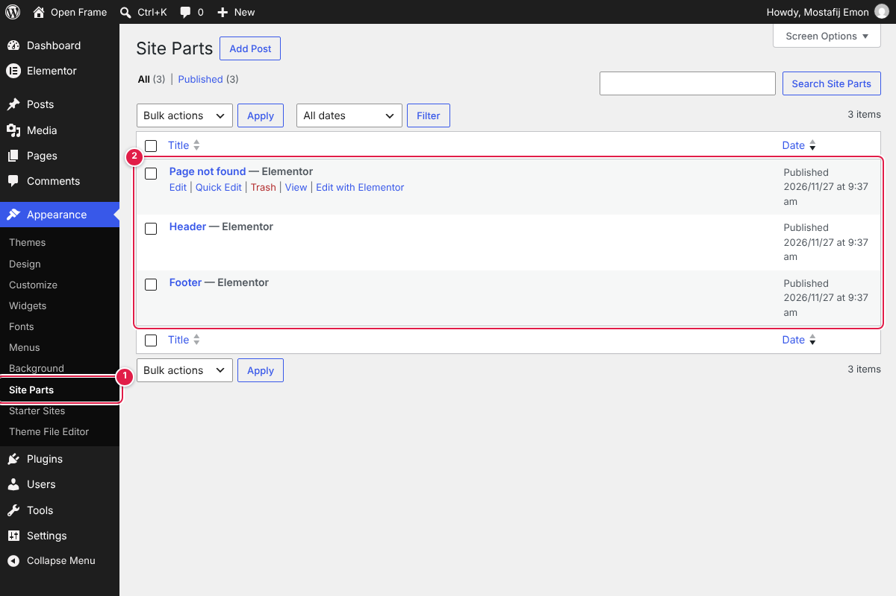

| # | What it is |
| --- | --- |
| 1 | **Appearance → Site Parts** |
| 2 | The three parts of the design: **Header**, **Footer** and **Page not found**. Each one opens in Elementor like a page |

The menu inside the header is your WordPress menu (**Appearance → Menus**), shown by the "Navigation Menu (Open Frame)" widget. On phones it becomes the menu button of the theme.

The **blog page, single articles, search results and archives** of these designs are drawn by the Open Frame theme, with the colors and fonts of the design. Their layout is set under **Appearance → Customize → Open Frame Options** (see [Blog and posts in the theme guide](README.md#16-blog-and-posts)).

To go back to the header and footer of the theme, move the Site Part to the trash.

### Designs for Elementor Pro: Theme Builder

Creative Agency, SaaS, Real Estate, Magazine and Shop bring templates for Elementor Pro's Theme Builder: header, footer, single article, archive (blog, categories, search results) and "page not found". Go to **Templates → Theme Builder**, or open the Elementor menu (marker 4 in the editor picture above) and choose **Theme Builder**.

Each template has **display conditions** that say where it is used ("Entire Site" for the header, "All Archives" for the blog, and so on). Open a template, click the arrow beside **Publish**, and choose **Display Conditions** to see or change them.

If your site uses both, a Theme Builder template takes priority over a Site Part.

## 9. Colors and fonts

### Colors

A design sets Elementor's four site-wide colors, **Primary**, **Secondary**, **Text** and **Accent**, and adds a few of its own (for example a tint for backgrounds and a color for lines). To change them, open any page in Elementor, open the Elementor menu, and choose **Site Settings → Global Colors**. A change there reaches every page of the design at once, and, because the import switches on the theme option "Use Elementor global colors and fonts", also the blog and the other pages drawn by the theme.

### Fonts

Each design brings its own fonts. The font files are saved on **your** server, in `wp-content/uploads/open-frame-fonts`, and your site serves them itself. No font service such as Google Fonts is contacted, which keeps your visitors' IP addresses with you and makes the pages load faster.

To change a font, go to **Site Settings → Global Fonts**. The fonts of the design are in the font list under **Starter site fonts**. If you choose a Google font from Elementor's list instead, Elementor loads it from Google, and your privacy policy should say so.

## 10. Forms

| Design | How visitors contact you |
| --- | --- |
| Business, Portfolio, Restaurant, Education, Medical | Buttons and links that open the visitor's email program or dial your telephone number. There is no form, because the free version of Elementor has no form widget. Replace the sample email address and telephone number with your own |
| Creative Agency, SaaS, Real Estate, Magazine, Shop | Forms made with the **Form** widget of Elementor Pro: contact, demo request, viewing request, subscription |

**Where form messages go.** A form sends an email to the administrator address of your site (**Settings → General → Administration Email Address**). To change the address or the wording, edit the page in Elementor, click the form, and open **Actions After Submit → Email**.

**Test every form before you launch.** Send a message to yourself. If nothing arrives, the form is rarely the cause: many hosting companies do not deliver email sent by WordPress reliably. An SMTP plugin connected to a mail service solves it.

If you want a form on a design for free Elementor, install a form plugin of your choice and place its widget or shortcode on the contact page.

## 11. The Shop design

Shop needs Elementor Pro and **WooCommerce**. The screen installs WooCommerce for you.

What the import adds: eight sample products with pictures, prices and categories, the home page, a lookbook, a shipping and returns page, a journal and a contact page. The **Shop, Cart, Checkout and My Account** pages are the ones WooCommerce creates itself; the design links to them and styles them through the theme.

What you still have to do before you can sell:

1. Run WooCommerce's own setup under **WooCommerce → Home**: your address, currency and taxes.
2. Add a payment method under **WooCommerce → Settings → Payments**.
3. Set your shipping zones and prices under **WooCommerce → Settings → Shipping**, and rewrite the "Shipping and Returns" page to match.
4. Replace the sample products under **Products** with your own.
5. Place a test order from start to finish.

A rollback removes the sample products and their categories again. Orders, customers and your WooCommerce settings are not touched.

## 12. Rolling back an import

**Roll back this import** undoes the most recent import. You find the button in the details of the imported design.

What a rollback does:

- removes the pages, articles, products, images, menus, Site Parts, templates and fonts that the import **added**;
- puts back what the import **changed**: your earlier home page, Elementor's Site Settings, the theme settings and the menu positions.

What you should know before you click:

- **Changes you made to imported pages are lost**, because those pages are removed. Pages you created yourself are not touched.
- **Only the most recent import can be rolled back.** Starting another import ends the possibility to roll back the one before it.
- Plugins that were installed for the design (Elementor, WooCommerce) stay installed. Remove them under **Plugins** if you no longer want them.

The screen asks for confirmation before it rolls back.

## 13. History and updates of a design

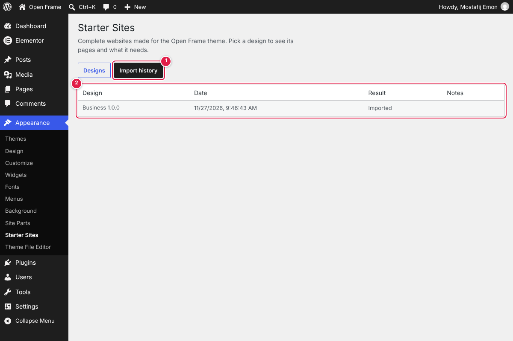

| # | What it is |
| --- | --- |
| 1 | **Import history** switches from the list of designs to the list of what was done on this site |
| 2 | One line per import or rollback: the design and its version, the date, the result, and notes (for example a picture that could not be downloaded). The twenty most recent lines are kept |

**Updates of a design.** Designs have version numbers. When the library has a newer version of a design you imported, its card shows **Update available**. Importing it again brings the new version, with the consequence described under [Importing a second time](#importing-a-second-time): your changes to the pages of that design are overwritten. A site that is finished does not need design updates; they matter when you are about to start a new site.

**Updates of the plugin** are described in the [support and update policy](SUPPORT.md).

## 14. Privacy

- **Your visitors:** the plugin does nothing on the public side of your site that contacts another server. Pages, pictures and fonts of a design are served by your own site.
- **The library:** when an administrator opens the Starter Sites screen, the plugin fetches the list of designs from `api.buildbetters.com`, and the administrator's browser loads the preview pictures from `cdn.buildbetters.com`. Both are run by the author of the plugin and served through Cloudflare. The request contains what every web request contains (the IP address of your server or browser) and the name and version of the plugin. **Nothing about your site, its address, its content or its users is sent.**
- **No tracking, no account, no licence check.**
- **Safety of downloads:** the list of designs carries a digital signature, and every package, picture and font is checked against it before it is used. A download that was damaged or altered on the way is refused. A design never contains program code: it is data (texts, pictures, fonts, Elementor settings), and the plugin refuses a package with script in it.
- **Installing Elementor or WooCommerce** from the screen is a download from WordPress.org, made by WordPress itself.

## 15. Troubleshooting

| What you see | What it means and what to do |
| --- | --- |
| The list of designs is empty, or "The starter site library could not be reached" | Your server could not open an HTTPS connection to the library. Click **Check for new designs** to try again. If it keeps failing, ask your hosting company whether outgoing HTTPS requests are allowed. A list that was fetched earlier keeps being shown |
| "The list of designs could not be verified, so it was not used" | The signature of the list did not match. Usually a temporary fault on the way. Try again later; if it persists, [report it](#17-support) |
| "…is damaged or was altered, so it was not used. Please try again." | A download arrived incomplete. Click **Try again** |
| A plugin cannot be installed: "needs WordPress …" or "needs PHP …" | The current version of that plugin needs a newer WordPress or PHP than your site has. Update WordPress, or ask your host for a newer PHP |
| "This design is built with Elementor containers. Turn on "Container"…" | Go to **Elementor → Settings → Features**, switch **Container** on, save, and import again |
| "The uploads folder cannot be written to" | Ask your hosting company to make `wp-content/uploads` writable |
| The import stops with an error | The screen shows the reason, with **Try again** and **Roll back**. Try again once; a single failed download is the usual cause |
| The window was closed during an import | Open **Appearance → Starter Sites** and click **Continue or roll back** in the notice at the top |
| "An earlier import did not finish. Continue it or roll it back first." | The same situation: finish or roll back the earlier import, then start the new one |
| "The import is already running in another window" | It runs in another browser tab. Wait a minute, or close the other tab |
| A picture is missing after the import | The history (chapter 13) names it under Notes. Import the design again to fetch it, or put your own picture there |
| The site looks unstyled right after the import | A cache is showing old files. Empty the cache of your cache plugin and of your host, and reload the page |
| The header of the theme shows instead of the header of the design | Free designs: check that **Appearance → Site Parts** has a published "Header". Pro designs: check that Elementor Pro is active and its licence is connected, and that the header template under **Templates → Theme Builder** has the condition "Entire Site" |
| Fonts look different from the preview | Empty your caches. Then check **Site Settings → Global Fonts**: the fonts of the design are under "Starter site fonts" |
| A form sends no email | See [Forms](#10-forms) |
| "Starter Sites" is missing from the Appearance menu | The plugin has to be active, and you have to be an administrator of the site |
| The screen says the Open Frame theme is not active | Activate Open Frame (or a child theme of it) under **Appearance → Themes**. The designs are made for this theme and cannot be imported into another one |

## 16. Removing the plugin

A site keeps working when the plugin is switched off or deleted, with two things to know for designs made for free Elementor:

- the **header, footer and "page not found" page** stored as Site Parts are shown by the plugin. Without it, the header and footer of the theme appear instead;
- the **fonts** of the design are served by the plugin. Without it, Elementor falls back to the next font in the list.

So keep the plugin active on a site that uses a free design. Designs for Elementor Pro keep their header, footer and templates, because those belong to Elementor Pro; only the fonts are affected.

Deleting the plugin removes its own data: the saved list of designs, the import history, the record of the last import, and the font files in `wp-content/uploads/open-frame-fonts`. **Pages, articles, products and pictures are your content and stay.**

## 17. Support

- Questions and bug reports: <https://github.com/Mostafijemon24/Open-Frame-Theme/issues>
- What is supported, for how long, and how updates are published: [support and update policy](SUPPORT.md)
- Changes in each version: the `== Changelog ==` section of the plugin's [`readme.txt`](../companion/open-frame-starter-sites/readme.txt)
- For developers: [plugin developer reference](dev/PLUGIN.md)
