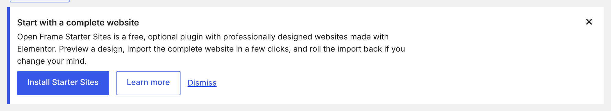
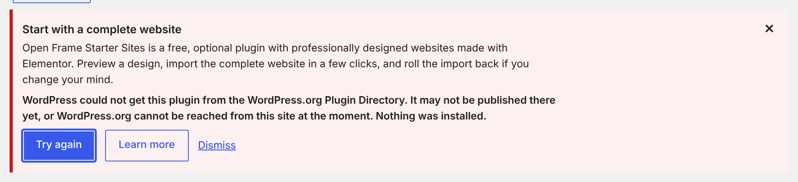

# Integration: the theme and the Starter Sites plugin

How the Open Frame theme recommends the Open Frame Starter Sites plugin, what has to be true before that works for the public, and the checklists for the two submissions to WordPress.org.

The state of the work, with test results and what is left for the owner, is in [FINAL_INTEGRATION_REPORT.md](FINAL_INTEGRATION_REPORT.md).

## The two products

Both live in this one repository and are released separately.

| | Theme | Plugin |
| --- | --- | --- |
| Name | Open Frame | Open Frame Starter Sites |
| Where | the repository root | `companion/open-frame-starter-sites/` |
| Text domain | `open-frame` | `open-frame-starter-sites` |
| Package | `bash bin/release-package.sh theme` | `bash bin/release-package.sh plugin` |
| Goes to | the WordPress.org Theme Directory | the WordPress.org Plugin Directory |
| Needs the other | No | Yes: a design can only be imported while Open Frame (or a child theme) is active |

The theme contains none of the plugin's functions. It only knows the plugin's name, its slug in the directory, and the address of its screen.

## What the user sees

After the theme is activated, one notice appears on the Dashboard, Themes and Plugins screens. It offers the step that fits the site.

| Status | When | Notice | Main button |
| --- | --- | --- | --- |
| A | The plugin is not installed | "Start with a complete website" | **Install Starter Sites**: WordPress installs it from WordPress.org. Not activated |
| B | Installed, not active | "…is installed but not active" | **Activate Starter Sites**: WordPress's own activation link |
| C | Active | "Starter Sites is ready" | **Open Starter Sites**: Appearance → Starter Sites; the notice then stays away |
| D | The installation failed | WordPress's own reason, as text | **Try again** |
| E | The directory does not list the plugin, or WordPress.org cannot be reached | "WordPress could not get this plugin from the WordPress.org Plugin Directory…" | **Try again**; **Learn more** leads to the plugin's directory page |
| Pending | The slug in `functions.php` is still the placeholder | Nothing: no notice, no installer screen, the installer library is not loaded | |

**Learn more** opens `https://wordpress.org/plugins/<slug>/`. **Dismiss** and the cross remember the choice per user (`open_frame_starter_notice_dismissed` in the user's meta data).





The plugin is also listed under **Appearance → Recommended Plugins**, the screen of the bundled TGM Plugin Activation library, while it is not installed or not active.

## The one line that switches it on

`functions.php`:

```php
define( 'OPEN_FRAME_STARTER_PLUGIN_SLUG', 'REPLACE_WITH_ACTUAL_APPROVED_WORDPRESS_ORG_SLUG' );
define( 'OPEN_FRAME_STARTER_PLUGIN_NAME', 'Open Frame Starter Sites' );
```

**The slug is pending.** The plugin is not in the WordPress.org Plugin Directory, so nobody knows its slug yet: WordPress.org assigns it when the plugin is approved, and may choose another one than the plugin's folder name. Do not guess it.

When the plugin is approved:

1. Read the slug from the plugin's address, `https://wordpress.org/plugins/<slug>/`.
2. Put it in place of the placeholder. If the reviewers changed the plugin's name, change the name too.
3. Raise the theme's version (a patch release), add the changelog line, build the package and release it.

A slug is lowercase letters, digits and hyphens. Anything else, the placeholder included, reads as "not known yet" and keeps everything switched off.

## How it is built

| File | What it does |
| --- | --- |
| `functions.php` | The two constants above |
| `inc/integrations/starter-sites.php` | Status of the plugin on the site, and its registration with TGM Plugin Activation |
| `inc/integrations/starter-sites-notice.php` | The notice, and its two requests for dismissing |
| `inc/tgmpa/class-tgm-plugin-activation.php` | TGM Plugin Activation 2.6.1, with the theme's text domain. Loaded on admin screens only, and only when the slug is set |
| `assets/js/admin-starter-notice.js` | Installs in place, shows errors, remembers a dismissal. Without it the buttons are plain links |
| `assets/css/admin-starter-notice.css` | A few lines of layout |

The registration with TGM Plugin Activation:

```php
array(
	'name'               => 'Open Frame Starter Sites',
	'slug'               => $slug,   // WordPress.org; no 'source', so no other download
	'required'           => false,
	'force_activation'   => false,
	'force_deactivation' => false,
)
```

with `is_automatic => false` (installing does not activate) and `has_notices => false` (the theme shows its own single notice instead of the library's).

**Installing.** The button sends WordPress's own `install-plugin` request (the one the Add Plugins screen uses), with WordPress's nonce, to a user who has the `install_plugins` capability. WordPress looks the slug up in the directory, downloads the package from `downloads.wordpress.org` and unpacks it. Without JavaScript, and when WordPress has to ask for FTP details first, the same button is a link to the Recommended Plugins screen, which does the same through `Plugin_Upgrader`.

**Activating** is WordPress's own link, `plugins.php?action=activate&plugin=…`, with its nonce.

**Who sees it.** Users who can `edit_theme_options` and can also do what the button offers: `install_plugins` (and file changes allowed) for status A, `activate_plugin` for B, access to the plugin's screen for C. Not in the network admin.

## Rules this keeps

- Only a plugin hosted on WordPress.org is recommended; there is no ZIP in the theme and no download address in the code.
- Recommended, not required. The theme is complete without it.
- Nothing is installed or activated without a click, and activation is a separate click.
- No redirect after the theme is activated.
- One notice, dismissible, on three screens only, through `admin_notices`.
- The theme makes no remote request. WordPress contacts WordPress.org when the user clicks **Install**.
- Nothing of the recommendation is loaded on the public side of the site.

## Elementor

The designs are made with Elementor; the theme and the plugin both work without it.

- The theme never installs Elementor and does not list it as a recommended plugin. Its notice mentions, once the plugin is active, when Elementor is not.
- The plugin's screen says above the designs when Elementor is not active. Each design lists what it needs under "What it needs", with a button that installs or activates Elementor from WordPress.org on request.
- Elementor Pro is needed by five of the ten designs (Agency, SaaS, Real Estate, Magazine, Shop; Shop also needs WooCommerce). The plugin detects it and links to it; it never installs it.

## Testing it before the plugin is published

`tests/e2e/recommendation.test.js` checks every status. Because the directory does not list the plugin yet, the test site can answer in the directory's place (`tests/env/mu-plugin.php`):

```bash
bash tests/env/setup.sh
php tests/env/run.php "$OFT_DIR/wordpress" tests/env/state.php \
	option:oft_starter_slug=open-frame-starter-sites \
	"option:oft_directory=zip:$PWD/dist/open-frame-starter-sites.zip"
```

- `oft_starter_slug` plays the part of the line in `functions.php`.
- `oft_directory=zip:<file>` makes the directory list the plugin with that file as its download. `down` makes WordPress.org unreachable. Empty asks the real WordPress.org.
- `state.php starter:reset` puts everything back; `starter:status` prints what the theme sees.

Two checks ask the real WordPress.org: for a slug that does not exist (status E), and for Hello Dolly, which shows that the button reaches the real directory and its real download.

## Checklist: submitting the plugin

Submit at <https://wordpress.org/plugins/developers/add/> from the owner's account.

| # | Point | State |
| --- | --- | --- |
| P1 | GPL-compatible licence, stated in the header and the readme; `LICENSE` in the package | Done |
| P2 | Stable tag, header version and `OFSS_VERSION` agree | Done (checked by `bin/release-package.sh`) |
| P3 | readme.txt: at most five tags, short description under 150 characters, "Tested up to" current | Done |
| P4 | "External services": what, when, what is sent, where, and the service's own terms and privacy policy | Done; the terms and privacy text is in [docs/SUPPORT.md](../SUPPORT.md#the-library-service) **Owner, 28 November 2026:** read and agreed. It has to be on `main` before submitting, because the readme links to it there |
| P5 | Nothing downloaded is executed: a design is data, the catalog is signed, every file is checked, the ZIP is never extracted, script in a page is refused | Done, with tests |
| P6 | Every REST route checks a capability; requests carry WordPress's nonce; output is escaped | Done (independent review, 28 November 2026) |
| P7 | Other plugins are installed only from WordPress.org, only on a click, with capability checks | Done |
| P8 | Unique prefixes of four characters or more (`ofss_`, `OFSS_`, namespace `OpenFrame\StarterSites`) | Done; the post type was renamed to `ofss_site_part` in 1.0.1 |
| P9 | No tracking, no account, no licence check, no upsell | Done |
| P10 | Plugin Check on the package | See the test report |
| P11 | The WordPress.org user name in `Contributors:` is the owner's real user name there | **Owner, 28 November 2026:** confirmed, `mostafijemon` |
| P12 | Banner, icon and screenshots (`.wordpress-org/`) | Done; they go into the `assets` folder of the SVN repository after approval |
| P13 | The plugin needs a theme that is not in the directory yet | Open: the readme says where to get the theme. A reviewer may still ask. Submitting the theme at the same time helps |

After approval WordPress.org sends the SVN address. The contents of the package go into `trunk` and into `tags/<version>`, the files of `.wordpress-org/` into `assets`. From then on the plugin has its slug.

## Checklist: submitting the theme

Upload at <https://wordpress.org/themes/upload/> from the owner's account.

| # | Point | State |
| --- | --- | --- |
| T1 | Theme Check on the package: nothing required, no warnings | See the test report |
| T2 | Only plugins from WordPress.org are recommended | Done: one plugin, by slug |
| T3 | The plugin is recommended, not required; nothing is forced | Done |
| T4 | No plugin ZIP in the theme; no plugin functions copied into it | Done |
| T5 | Nothing is installed or activated automatically; no redirect on activation | Done, with tests |
| T6 | Admin notices use `admin_notices`, are dismissible and stay dismissed | Done, with tests |
| T7 | Bundled library named with its licence and source in readme.txt; its text domain is the theme's | Done (TGM Plugin Activation 2.6.1, GPL-2.0-or-later) |
| T8 | No PHP errors, warnings or notices with `WP_DEBUG` | Done, with tests |
| T9 | No remote requests by the theme; fonts local | Done |
| T10 | The slug of the recommended plugin is the approved one | **Pending**: placeholder until the plugin is approved |

**Order.** The plugin and the theme can be submitted at the same time. The theme package made now recommends nothing (status "Pending"), so it is safe to submit before the plugin is approved; the recommendation reaches users with the first theme update after the slug is set. A theme that names a plugin the directory does not list must not be submitted.
